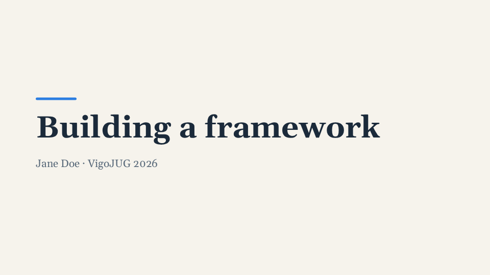
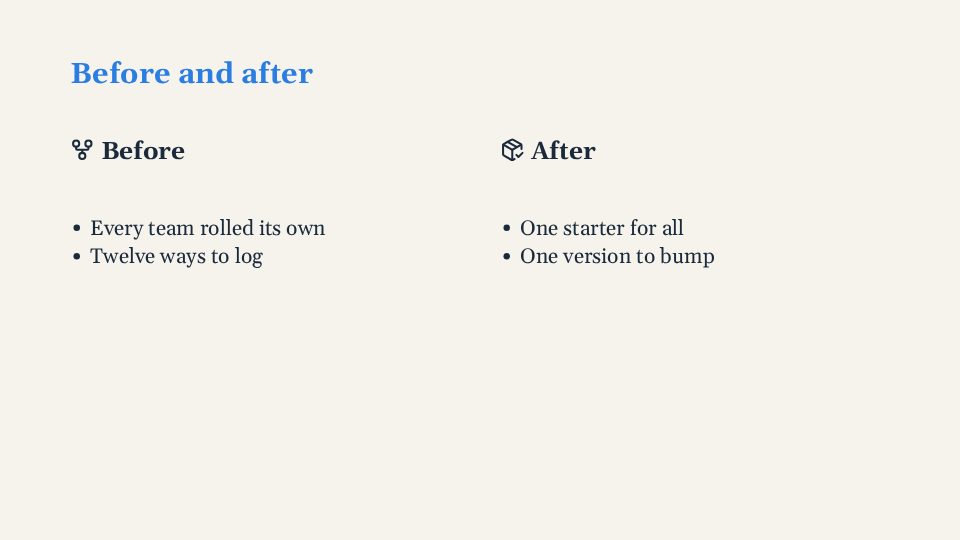
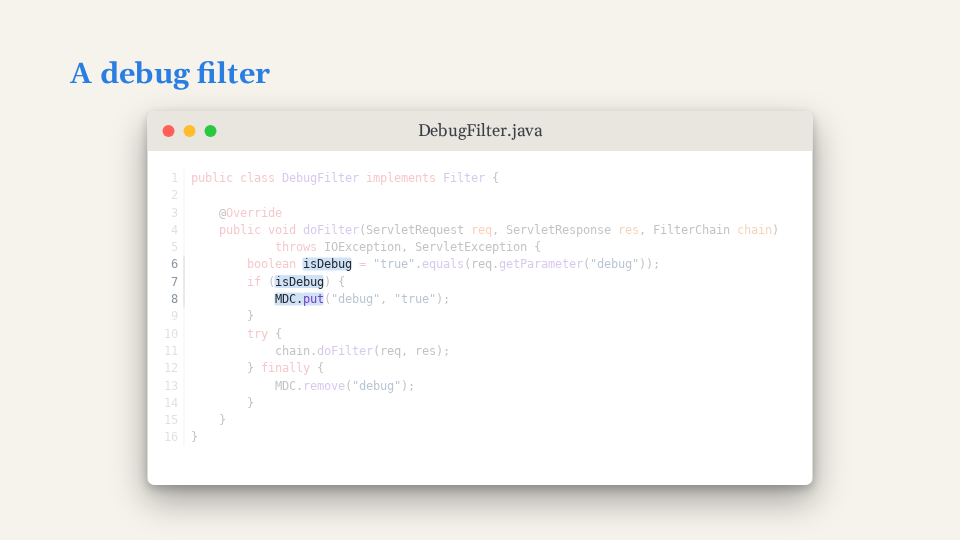
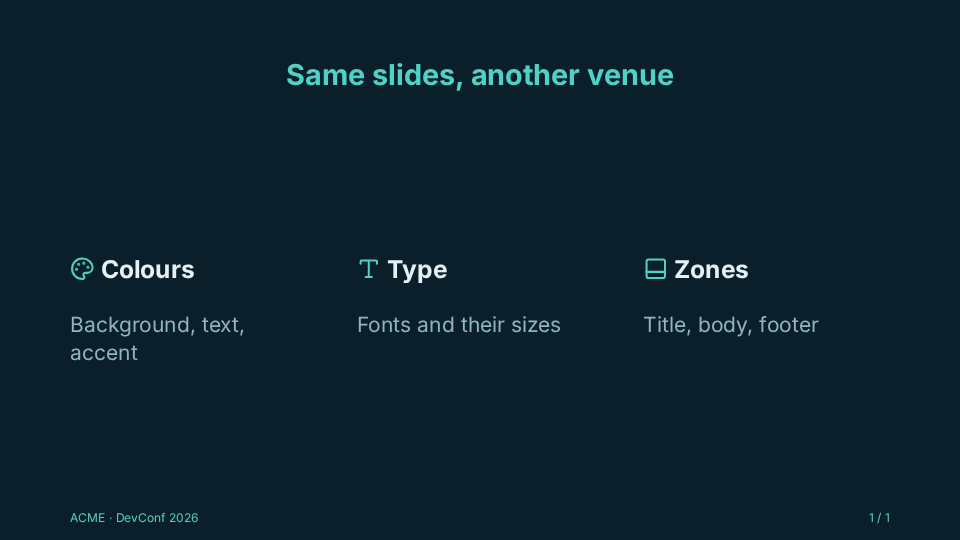
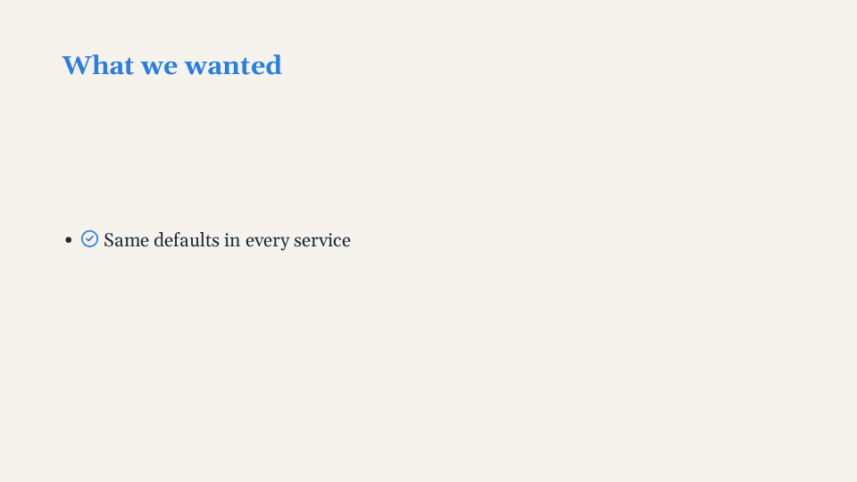
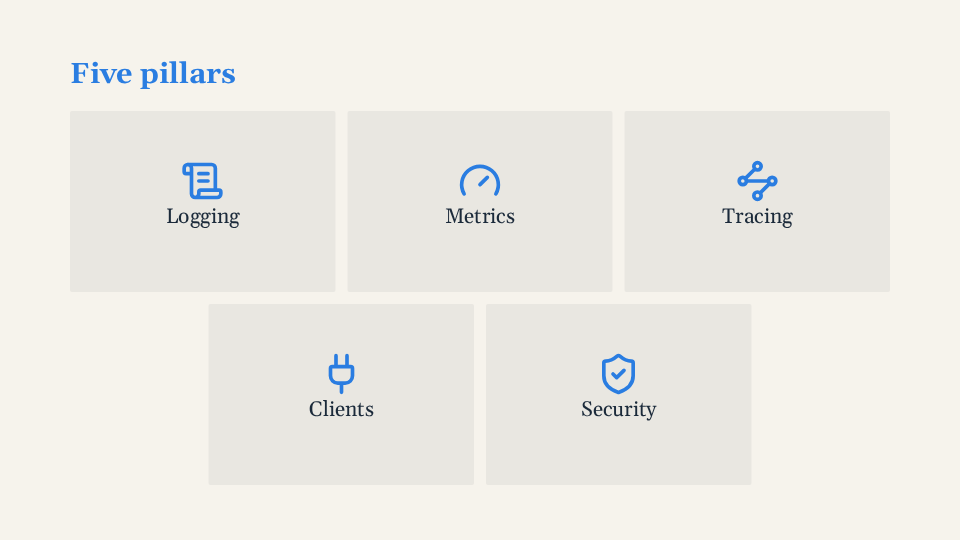
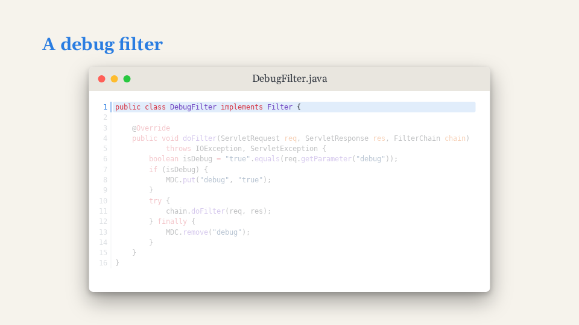
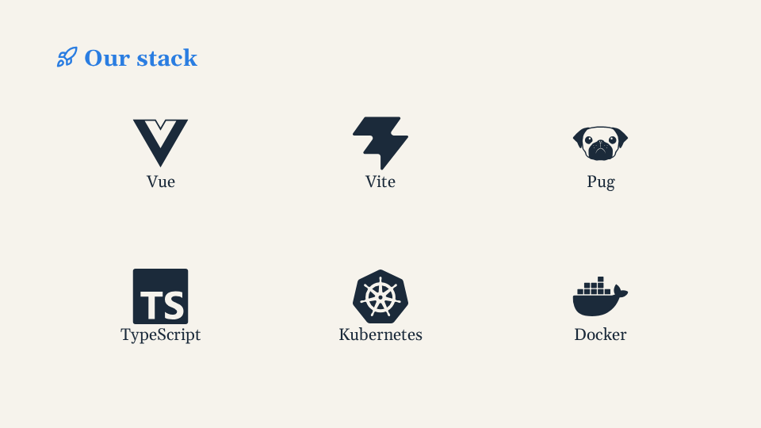
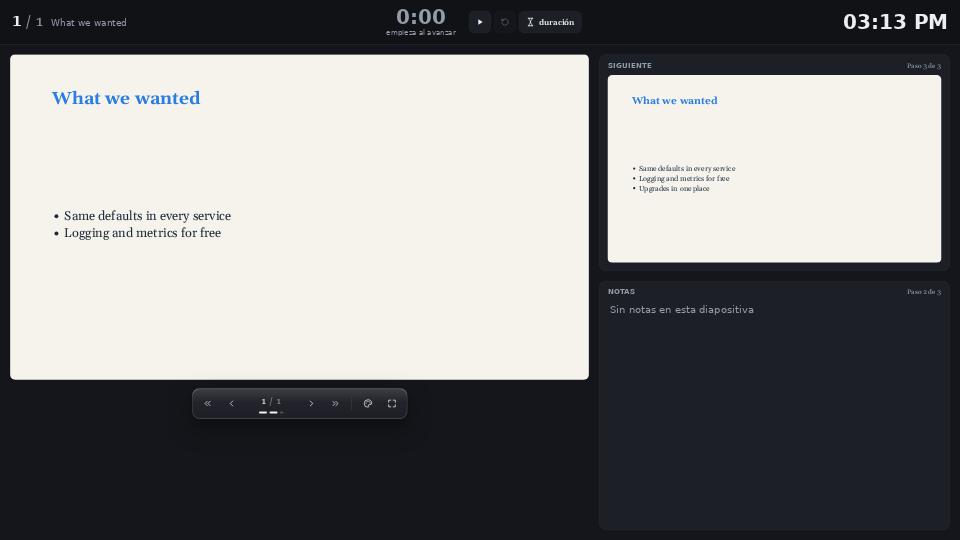
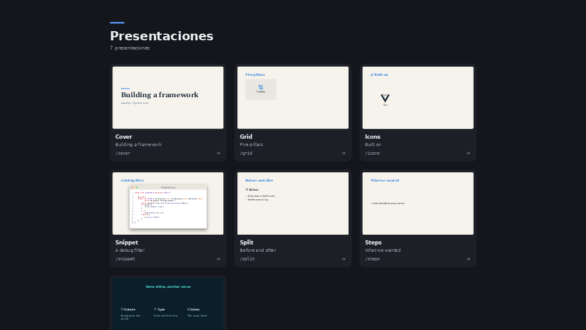

<!-- Header: .github/assets/readme-header*.svg (text as paths, so it renders the same everywhere). Badges: shieldcn
     (https://shieldcn.dev), each a light/dark pair so the row follows the reader's GitHub theme. -->
<picture>
  <source media="(prefers-color-scheme: dark)" srcset=".github/assets/readme-header-on-dark.svg" />
  
</picture>

<p>
  <a href="https://github.com/rubasace/araojs/actions/workflows/ci.yml"><picture><source media="(prefers-color-scheme: dark)" srcset="https://shieldcn.dev/github/ci/rubasace/araojs.svg?variant=secondary&size=sm&workflow=ci.yml&branch=main&mode=dark" /></picture></a>
  <a href="https://www.npmjs.com/package/araojs"><picture><source media="(prefers-color-scheme: dark)" srcset="https://shieldcn.dev/npm/araojs.svg?variant=secondary&size=sm&mode=dark" /></picture></a>
  <a href="LICENSE"><picture><source media="(prefers-color-scheme: dark)" srcset="https://shieldcn.dev/badge/license-Apache--2.0.svg?variant=secondary&size=sm&mode=dark" /></picture></a>
  <picture><source media="(prefers-color-scheme: dark)" srcset="https://shieldcn.dev/badge/node-%3E%3D20.19.svg?variant=secondary&size=sm&logo=nodedotjs&mode=dark" /></picture>
  <a href="https://vuejs.org/"><picture><source media="(prefers-color-scheme: dark)" srcset="https://shieldcn.dev/badge/vue-3.svg?variant=secondary&size=sm&logo=vuedotjs&mode=dark" /></picture></a>
  <a href="https://vite.dev/"><picture><source media="(prefers-color-scheme: dark)" srcset="https://shieldcn.dev/badge/vite-8.svg?variant=secondary&size=sm&logo=vite&mode=dark" /></picture></a>
</p>


# Arao

**Slides as Vue components.** A deck is one Vue file, in Pug or HTML; Arao draws every slide on
one fixed canvas, so your laptop, the projector, the presenter view and the PDF show the same
slide, with the same line breaks.

<p align="center">
  
</p>

**Contents:** [Why Arao](#why-arao) · [Quick start](#quick-start) · [Code and slide](#code-and-slide) ·
[Features](#features) · [Documentation](#documentation) · [License](#license)

## Why Arao

<table>
<tr>
<td>

Arao continues the idea of [eagle.js](https://github.com/Zulko/eagle.js): **a slideshow is a Vue
app, slides are components, and anything Vue can do, a slide can do.** eagle.js was built for
Vue 2 and is no longer maintained; Arao takes the same idea and rebuilds it for Vue 3 and Vite,
around a fixed canvas, absolute steps and themes made of tokens.

eagle.js had its bird; so does Arao. The *arao* is the **common guillemot**, a black-and-white
diving seabird of the **Cíes islands**, off Vigo.

</td>
</tr>
</table>

## Quick start

```bash
npm install araojs vue && npm install -D vite
```

```js
// vite.config.js
import { defineConfig } from 'vite'
import arao from 'araojs/vite'
export default defineConfig({ plugins: [arao()] })

// src/main.js (and index.html: <div id="app"></div> <script type="module" src="/src/main.js"></script>)
import { createDeckApp } from 'araojs'
createDeckApp().mount('#app')
```

```bash
# write src/decks/MyTalk.vue, then:
npx vite                                # open http://localhost:5173/mytalk
npx playwright-core install chromium    # once, for the PDF export
npx arao export --deck mytalk           # exports/mytalk.pdf
```

The whole walkthrough, with a first deck: [Getting started](docs/getting-started.md).

## Code and slide

<table>
<tr>
<td width="50%">

<!-- example:cover -->

```vue
<template lang="pug">
Deck
  Slide(layout="cover")
    .bar
    h1 Building a framework
    p.muted Jane Doe · VigoJUG 2026
</template>
```

<!-- /example -->

</td>
<td width="50%"></td>
</tr>
<tr>
<td>

<!-- example:split -->

```vue
<template lang="pug">
Deck
  Slide(layout="split")
    h2 Before and after
    template(#left)
      h3 #[Icon(name="lucide:git-fork")] Before
      ul
        li Every team rolled its own
        li Twelve ways to log
    template(#right)
      h3(v-step="2") #[Icon(name="lucide:package-check")] After
      ul(v-step="2")
        li One starter for all
        li One version to bump
</template>
```

<!-- /example -->

</td>
<td width="50%"></td>
</tr>
<tr>
<td>

<!-- example:snippet -->

```vue
<template lang="pug">
Deck
  Slide
    h2 A debug filter
    Snippet(file="DebugFilter.java" :highlights='{ "1": 2, "6-8:isDebug+++MDC.put": 3 }')
</template>
```

<!-- /example -->

</td>
<td></td>
</tr>
<tr>
<td>

<!-- example:themes/ocean.css -->

```css
/* docs/examples/themes/ocean.css: a theme declares only the tokens it changes */
[data-theme="ocean"] {
  --ar-bg: #0b1f2a;
  --ar-fg: #e6f1f5;
  --ar-muted: #8fb3c2;
  --ar-accent: #4fd1c5;
  --ar-accent-fg: #0b1f2a;
  --ar-letterbox: #06141b;
  --ar-font-sans: "Inter", system-ui, sans-serif;
  --ar-title-align: center;
  --ar-footer-color: var(--ar-accent);
}
```

<!-- /example -->

</td>
<td></td>
</tr>
</table>

Every picture is drawn from the deck beside it ([docs/examples](docs/examples/)).

## Features

<table>
<tr>
<td width="33%" align="center"><a href="docs/guide/steps.md"></a><br/><b><a href="docs/guide/steps.md">Steps</a></b></td>
<td width="33%" align="center"><a href="docs/guide/composition.md"></a><br/><b><a href="docs/guide/composition.md">Composition</a></b></td>
<td width="33%" align="center"><a href="docs/guide/code.md"></a><br/><b><a href="docs/guide/code.md">Code with highlights</a></b></td>
</tr>
<tr>
<td width="33%" align="center"><a href="docs/guide/icons.md"></a><br/><b><a href="docs/guide/icons.md">Icons by name</a></b></td>
<td width="33%" align="center"><a href="docs/guide/presenting.md"></a><br/><b><a href="docs/guide/presenting.md">Presenter view</a></b></td>
<td width="33%" align="center"><a href="docs/guide/project.md#the-list-of-decks"></a><br/><b><a href="docs/guide/project.md#the-list-of-decks">Every deck, one URL</a></b></td>
</tr>
</table>

- **One fixed canvas**, 1920x1080 by default, scaled to any window: [Concepts](docs/guide/concepts.md)
- **Steps** that a slide counts on its own, and reusable ones: [Steps](docs/guide/steps.md)
- **Layouts and composition** by props, no CSS: [Layouts](docs/guide/slides-and-layouts.md) · [Composition](docs/guide/composition.md)
- **Code windows** with [Shiki](https://shiki.style/) colours and highlights per step: [Code](docs/guide/code.md)
- **Icons**: any [Iconify](https://icon-sets.iconify.design/) icon by name, offline: [Icons](docs/guide/icons.md)
- **Pictures and backgrounds** named from a folder: [Images](docs/guide/images-and-backgrounds.md)
- **Themes as tokens**, switched live with `t`: [Themes](docs/guide/themes.md)
- **Presenter view**: next step, notes, a countdown, every window in step: [Presenting](docs/guide/presenting.md)
- **A URL per deck**, and `/` lists them with their covers: [The project](docs/guide/project.md#the-list-of-decks)
- **Keyboard and touch**: keys, a jump menu, taps and swipes: [Controls](docs/guide/presenting.md#controls)
- **PDF export**, a page per step or per slide, text kept as text: [Export](docs/guide/export.md)
- **Written by people or by agents**: [AGENTS.md](AGENTS.md) ships with the package

## Documentation

| | |
|---|---|
| [Getting started](docs/getting-started.md) | from an empty folder to a deck on the screen and in a PDF |
| [Guides](docs/index.md#guides) | layouts, steps, code, icons, themes, presenting, export, hosting, extending |
| [Reference](docs/index.md#reference) | every component, directive, composable, token, plugin option, CLI flag and URL |
| [AGENTS.md](AGENTS.md) | the guide for AI agents writing decks (`node_modules/araojs/AGENTS.md` in a project) |
| [CONTRIBUTING.md](CONTRIBUTING.md) | developing, testing, documenting and releasing Arao |

## License

<table>
<tr>
<td>

**[Apache License 2.0](LICENSE)** · Copyright 2026 Ruben Pahino

<sub>Arao owes its starting idea to [eagle.js](https://github.com/Zulko/eagle.js), by Zulko and its
contributors: slides as Vue components. Icons come from the [Lucide](https://lucide.dev) and
[Simple Icons](https://simpleicons.org) sets through [Iconify](https://iconify.design), and code
colours from [Shiki](https://shiki.style/), each under its own licence.</sub>

</td>
</tr>
</table>
