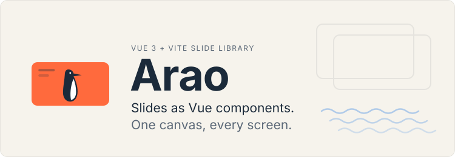

<!-- Header: .github/assets/readme-header*.svg (text as paths, so it renders the same everywhere). Badges: shieldcn
     (https://shieldcn.dev), each a light/dark pair so the row follows the reader's GitHub theme. -->
<picture>
  <source media="(prefers-color-scheme: dark)" srcset=".github/assets/readme-header-on-dark.svg" />
  
</picture>

<p>
  <a href="https://github.com/rubasace/araojs/actions/workflows/ci.yml"><picture><source media="(prefers-color-scheme: dark)" srcset="https://shieldcn.dev/github/ci/rubasace/araojs.svg?variant=secondary&size=sm&workflow=ci.yml&branch=main&mode=dark" /></picture></a>
  <a href="https://www.npmjs.com/package/araojs"><picture><source media="(prefers-color-scheme: dark)" srcset="https://shieldcn.dev/npm/araojs.svg?variant=secondary&size=sm&mode=dark" /></picture></a>
  <a href="LICENSE"><picture><source media="(prefers-color-scheme: dark)" srcset="https://shieldcn.dev/badge/license-Apache--2.0.svg?variant=secondary&size=sm&mode=dark" /></picture></a>
  <picture><source media="(prefers-color-scheme: dark)" srcset="https://shieldcn.dev/badge/node-%3E%3D20.19.svg?variant=secondary&size=sm&logo=nodedotjs&mode=dark" /></picture>
  <a href="https://vuejs.org/"><picture><source media="(prefers-color-scheme: dark)" srcset="https://shieldcn.dev/badge/vue-3.svg?variant=secondary&size=sm&logo=vuedotjs&mode=dark" /></picture></a>
  <a href="https://vite.dev/"><picture><source media="(prefers-color-scheme: dark)" srcset="https://shieldcn.dev/badge/vite-8.svg?variant=secondary&size=sm&logo=vite&mode=dark" /></picture></a>
</p>

# Arao

**Arao** is a slide library for technical talks, built on **Vue 3 + Vite**. A deck is a Vue file:
slides are components, written as plain **HTML** or as **Pug** (supported out of the box and
recommended for brevity). Every slide is drawn on one fixed canvas and scaled to the screen, so
your laptop, the projector, the presenter view and the PDF all show the same slide, with the same
line breaks. Themes are only CSS tokens, layouts are props, and a deck needs little or no CSS of
its own.

Arao is a library (the `araojs` package: the engine, its components, addons, its default theme,
a Vite plugin and the PDF export). Decks live in a **slides project** of their own that depends on
it.

> **Status:** the first release is not on npm yet (the `araojs` name holds a placeholder). Until
> then a project uses it from a checkout, `"araojs": "file:../araojs"` (run `npm run build` here
> after each change to the library), or from a tarball made with `npm pack`.

## Why Arao

Arao continues the idea of [eagle.js](https://github.com/Zulko/eagle.js): a slideshow is a Vue
app, slides are components, and anything Vue can do, a slide can do. eagle.js was built for Vue 2
and is no longer maintained; Arao takes the same idea and rebuilds it for Vue 3 and Vite, around a
fixed canvas, absolute steps and themes made of tokens. eagle.js had its bird; so does Arao: the
*arao* is the common guillemot, a seabird of the Cíes islands off Vigo.

## Features

- **One fixed canvas.** 1920x1080 px by default (`Deck(:width="…" :height="…")` sets another),
  scaled to the window with a CSS transform. Every size inside a slide is canvas px.
- **Steps.** `v-step="n"` shows an element from step `n` of its slide; `.only` and `.collapse`
  variants; `v-step-from` makes a reusable component's steps relative. A slide counts its own
  steps: nothing to declare.
- **Layouts and composition.** `Slide(layout=…)`: `cover`, `section`, `split`, `image-left`,
  `image-right`, with `ratio`. `Cols`, `Rows`, `Grid` and `Center` arrange boxes by props
  (`ratio`, `gap`, `align`, `cols`), no CSS needed.
- **Slide zones and footer.** A content slide is a header (the heading it starts with), a body
  (centred by default, or `Slide(align=…)`) and the deck's `#footer`, drawn as real text on every
  content slide.
- **Code.** `Snippet`: a macOS-style window with [Shiki](https://shiki.style/) colours, files
  named from a folder, the same frame and font size on every slide, and line and word highlights
  per step.
- **Icons.** `Icon(name="lucide:rocket")`: any [Iconify](https://icon-sets.iconify.design/) icon
  by name, resolved at build time. Offline when presenting, vectors in the PDF.
- **Pictures and backgrounds.** `Img(file=…)` and `Slide(bg=…)` with fit, position, opacity and
  blur; a dashed placeholder names a missing file.
- **Themes as tokens.** A theme is a block of `--ar-*` CSS variables over the defaults, in a file
  of `src/themes`, found on its own. Same slides, another venue: only the theme changes, live
  (`t`, the picker, `?theme=`).
- **Presenter view.** Current slide, next step, speaker notes, a timer with countdown (its duration
  can be changed live) and the wall clock; every window of the deck stays in step.
- **A URL per deck.** `/mytalk`, under any base; `/` shows every deck of the project as a card
  with its cover drawn live.
- **Keyboard and touch.** Keys, a jump menu, tap and swipe on phones and tablets.
- **PDF export.** `arao export`: every deck of the project, one PDF each; one page per step (or
  per slide), text kept as text, optional notes pages.
- **Written by people or by agents.** The declarative style keeps decks short and regular, which
  also makes them easy for AI agents to write: [AGENTS.md](AGENTS.md) is their guide, and ships
  with the package.

## Quick start

A slides project is a Vite app with `araojs` (and `vue` and `vite`, its peers):

```bash
npm install araojs vue && npm install -D vite
```

```js
// vite.config.js
import { defineConfig } from 'vite'
import arao from 'araojs/vite'

export default defineConfig({ plugins: [arao()] })
```

```js
// src/main.js
import { createDeckApp } from 'araojs'

createDeckApp().mount('#app')
```

```html
<!-- index.html -->
<div id="app"></div>
<script type="module" src="/src/main.js"></script>
```

```json
"scripts": { "dev": "vite", "build": "vite build", "export": "arao export" }
```

That is the whole setup:

- `arao()` is the only Vite plugin: it brings `@vitejs/plugin-vue` and Pug along (don't add
  `vue()` too; Vue's options go in `arao({ vue: { … } })`), serves the project's folders (decks in
  `src/decks`, code files in `src/snippets`, pictures in `src/images`, themes in `src/themes`,
  each one an option) and builds in the icons the source names.
- `createDeckApp()` creates the Vue app with the engine installed and renders the deck the URL's
  path names (`/mytalk`), or at `/` the list of decks (a project with one deck opens it there;
  `createDeckApp({ deckList: 'always' })` lists it anyway). A project with its own app shell uses
  `createApp(MyApp).use(Arao)` instead (`import Arao from 'araojs'`).
- The engine's CSS comes with `'araojs'`, and so do the project's themes: every CSS file of
  `src/themes` is loaded with nothing to import ([Themes](#themes)).

### A first deck

Create `src/decks/MyTalk.vue` (and put a `DebugFilter.java` in `src/snippets/`):

```pug
<template lang="pug">
Deck(duration="30m")
  ProgressBar
  SlideNumber

  Slide(layout="cover")
    .bar
    h1 My talk
    p.muted Jane Doe · Conf 2026

  Slide
    h2 Three things
    ul
      li First, from the start
      li(v-step="2") Second, at step 2
      li(v-step="3") Third, at step 3
    Notes
      p Speaker notes: only the presenter view shows them.

  Slide(title="The code")
    h2 The code
    Snippet(file="DebugFilter.java" :highlights='{ "8-10": 2 }')

  Slide(layout="section")
    h1 Thanks!
</template>

<script setup>
import { ProgressBar, SlideNumber } from 'araojs'
</script>
```

The same deck in HTML: a `<template>` with no `lang`, with the same components, props, slots and
directives. Each file picks its own syntax; the `<script setup>` does not change.

```vue
<template>
  <Deck duration="30m">
    <ProgressBar />
    <SlideNumber />

    <Slide layout="cover">
      <div class="bar"></div>
      <h1>My talk</h1>
      <p class="muted">Jane Doe · Conf 2026</p>
    </Slide>

    <Slide>
      <h2>Three things</h2>
      <ul>
        <li>First, from the start</li>
        <li v-step="2">Second, at step 2</li>
        <li v-step="3">Third, at step 3</li>
      </ul>
      <Notes><p>Speaker notes: only the presenter view shows them.</p></Notes>
    </Slide>

    <Slide title="The code">
      <h2>The code</h2>
      <Snippet file="DebugFilter.java" :highlights='{ "8-10": 2 }' />
    </Slide>

    <Slide layout="section">
      <h1>Thanks!</h1>
    </Slide>
  </Deck>
</template>
```

`Deck`, `Slide`, `Img`, `Icon`, `Snippet`, `Notes`, `Cols`, `Rows`, `Grid`, `Center` and the
`v-step` and `v-step-from` directives are registered globally. Addons (`ProgressBar`,
`SlideNumber` from `'araojs'`, or your own) are imported.

Then `npm run dev` and open `http://localhost:5173/`:

| URL | What it opens |
|---|---|
| `/` | the list of the project's decks: a card each, with its cover drawn in it (a project with one deck opens it, and `/` and `/mytalk` are then the same deck to every window) |
| `/mytalk` | the deck `src/decks/MyTalk.vue` (the name is case-insensitive) |
| `/mytalk?theme=acme` | the same deck with another of its themes |
| `/mytalk#/5/2` | slide 5, step 2 (the hash follows you as you move) |
| `/mytalk?presenter` | the presenter view |
| `/mytalk?export` | the deck as a book of pages, for printing |

A name that is no deck shows the list too, with a notice (and a warning in the console). The old
form, `/?deck=mytalk`, still opens the deck, and the address bar turns it into `/mytalk`. Under a
sub-path (Vite's `base: '/talks/'`) every path is under it: `/talks/`, `/talks/mytalk`.

### Project layout

```
package.json        depends on araojs; scripts dev, build, export
vite.config.js      plugins: [arao()]
index.html          <div id="app"> and /src/main.js
src/
  main.js           createDeckApp().mount('#app')
  decks/            one .vue file per deck (/<file name>)
    <talk>/         components only that talk uses
  slides/           components shared by several decks
  snippets/         code files shown by Snippet(file="…"), by name (subfolders allowed)
  images/           pictures used by Img(file="…") and Slide(bg="…"), by name (subfolders allowed)
  themes/           the project's themes, if any: CSS files, each [data-theme="<name>"] a theme
```

A component written for one talk goes in `src/decks/<talk>/`; one that several decks use goes in
`src/slides/`. Neither is registered globally: the deck imports it
(`import Card from '../slides/Card.vue'`).

## Writing slides

The [reference](docs/reference.md) has every prop, slot, token and URL parameter; these are the
essentials.

### Steps

Steps are absolute numbers within a slide: `v-step="3"` means "from step 3 of this slide", and
step 1 is what shows when the slide arrives. The slide's step count is the largest step inside it.

```pug
Slide
  h2 One at a time
  p Always visible.
  p(v-step="2") From step 2.
  p(v-step.only="3") Only at step 3 (keeps its space).
  p(v-step.only.collapse="4") Only at step 4 (takes no space).
```

`.collapse` takes no space while hidden, and the elements around it glide into place. Inside a
reusable component, number its steps from 1 and place it with `v-step-from`:
`Card(v-step-from="5")` shows the card's step 1 at step 5 of the slide
([v-step-from](docs/reference.md#v-step-from-relative-steps-for-reusable-components)).

### Layouts and composition

```pug
Slide(layout="split")
  h2 Before and after
  template(#left)
    h3 Before
    p Every team rolled its own.
  template(#right)
    h3(v-step="2") After
    p(v-step="2") One starter, one version.

Slide
  h2 Three pillars
  Cols(gap="lg")
    div
      h3 Logging
    div(v-step="2")
      h3 Metrics
    div(v-step="3")
      h3 Clients
```

Layouts: `default`, `cover`, `section`, `split` (two named zones), `image-left` / `image-right`
(an edge-to-edge picture beside the text), with `ratio="3 2"`. Pieces: `Cols(ratio="2 1")`,
`Rows`, `Grid(cols="3")` or `Grid(ratio="2:1")` (the count decides the shape), `Center`. A
`Deck`'s `#footer` slot draws on every slide except covers and sections, with the slide number if
wanted. Plain tables and lists are styled by the theme.

### Code

```pug
Slide(title="A debug filter")
  h2 A debug filter
  Snippet(file="DebugFilter.java" :highlights='{ "2": 2, "8-10:isDebug+++MDC.put": 3 }')
```

Step 1 shows the code plain; at step 2 line 2 is highlighted; at step 3 only those words on lines
8-10. Each step shows only its own rules. Every snippet has the same frame and font size, and
shrinks only when the code would not fit. Inline code:
`Snippet(code="npm run dev" lang="bash" name="terminal" fit :line-numbers="false")`.

### Pictures and icons

```pug
Slide(layout="image-right" ratio="3 2")
  template(#image)
    Img(file="team.jpg" alt="The team")
  h2 #[Icon(name="lucide:users")] One picture, one idea
  Icon(name="simple-icons:kubernetes" size="120" label="Kubernetes")
```

`Img` takes `fit`, `position`, `opacity`, `blur` and `rounded`. `Slide(bg=…)` takes a picture, a
URL, a colour or a gradient, tuned with `bg-opacity`, `bg-position`, `bg-blur` and `bg-fit`; a
`#background` slot takes anything.

Icons are inline SVG in the text colour, `1em` tall or `size` px. Lucide (UI icons) and Simple
Icons (technology logos) come with the library; any other Iconify set works after
`npm install -D @iconify-json/<prefix>`. The plugin builds in only the icons whose full names
appear in the source, so nothing is fetched while presenting. Sets and their licences:
[Icon](docs/reference.md#icon).

### Themes

Every token has a default, and the defaults are the `default` theme: a light page, Georgia, a
blue accent, a light code window. A theme is a rule of tokens in a CSS file of `src/themes` that
declares only what it changes; the plugin finds the file and loads it, with nothing to import:

```css
/* src/themes/acme.css */
[data-theme="acme"] {
  --ar-bg: #0f1115;
  --ar-fg: #e8e8ea;
  --ar-accent: #ff6a3d;
  --ar-font-sans: "Inter", system-ui, sans-serif;
  /* … */
}
```

The theme's name is the one in its selector (`acme`), not the file's: one file may hold several
themes. A deck without `themes` offers all of them, `default` first and then the project's in
alphabetical order; `Deck(:themes="['acme', 'default']")` picks some, in its order (the first is
the one it opens in). A theme from anywhere else (a CSS file the project imports itself from
`src/styles`, a package, a `.scss` file) is worn by a deck that lists it in `themes`, but not
offered by one without a list ([Themes](docs/reference.md#themes)). Tokens cover colours, fonts,
sizes, title and body placement, footer,
tables, code, and the deck's own interface (controls, presenter view, export notes)
([Theme tokens](docs/reference.md#theme-tokens)). No theme ships with the package but the
defaults. In a slide, style through tokens (`color: var(--ar-accent)`) rather than fixed colours.
Utility classes (`.muted`, `.center`, `.upper`, `.small`) are there as an escape hatch.

## Presenting

| Key | Action |
|---|---|
| `→` `↓` `PageDown` `Space` `Enter` | next step (then next slide) |
| `←` `↑` `PageUp` `Backspace` | previous step |
| `Home` / `End` | first slide / last step of the last slide |
| `g`, or a digit | jump menu (search by number or title; a digit pre-fills it) |
| `Esc` | close the open panel (jump menu or theme picker) |
| `t` | next theme of the deck |
| `f` | fullscreen |
| `p` | open (or bring forward) the presenter window |

Keys with Ctrl, Cmd or Alt are left to the browser. Letter keys act in lowercase only: with Caps
Lock on (or Shift held), `g` `t` `f` `p` do nothing. Moving the mouse shows the controls
(first/prev/next/last, slide counter with step dots, jump menu, theme picker, presenter view,
fullscreen); they never show on keyboard navigation and hide after 2.5 s without movement. On a
touch screen, tap the right edge for next, the left edge for previous and the middle for the
controls; swiping left or right also navigates.

### Presenter view

Press `p` (or the controls' screen button, or open the deck's URL with `?presenter`). A separate window
shows the current slide with the controls under it, a preview of what the next press shows, the
speaker notes of the slide (what the current step brings is marked), the slide number
and title, the timer and the wall clock.

The timer starts with the first move in any window; it can be paused and reset, and it survives
reloading the windows. With a duration it also counts down: amber near the end, red when over.
All windows of the same deck in the same browser follow each other (position, theme, timer,
duration). If the browser blocks the pop-up, a notice offers a link to open it by hand. The
presenter UI is in Spanish.

The talk's duration is set in the deck, `Deck(duration="45m")` (or `90`, `"1h30"`, `"45:00"`…). The
same talk often gets another slot: change it live from the presenter view, without editing the
deck. The duration button in the top bar (next to the timer's) opens a field that takes the same
formats, from 1 minute to 24 hours; `Enter` applies, `Esc` cancels, and `Space` then moves the
slides again at once. A deck without `duration` gets a countdown the same way. Every window of
the deck takes the new duration, it survives reloading them, it wins over the deck until reset, and
the same field goes back to the deck's value.

## Export to PDF

In a slides project (`"export": "arao export"` in its scripts; `npx arao export …` works too):

```bash
npx playwright-core install chromium      # once: the Chromium that playwright-core drives
npm run export                                        # every deck: exports/<deck>.pdf each
npm run export -- --deck mytalk                       # exports/mytalk.pdf
npm run export -- --deck mytalk --theme acme --per-slide --notes --out talk.pdf
```

| Option | Meaning |
|---|---|
| `--deck <name>` | just this deck of the decks folder, `src/decks` (default: every deck, one PDF each) |
| `--theme <name>` | one of the deck's themes (default its first); with several decks, only the decks that list it use it |
| `--per-slide` | one page per slide, each at its last step, instead of one per step |
| `--per-step` | one page per step: the default, still accepted (not together with `--per-slide`) |
| `--notes` | a page with the speaker notes after each slide that has them |
| `--out <path>` | output file or folder (default `exports/<deck>[-<theme>][-slides][-notes].pdf`); with several decks always a folder (a path ending in `.pdf` is an error) |
| `--url <url>` | print from a running server instead of building: the site's URL, its base (`http://127.0.0.1:5173/`, or `…/talks/` under a base) |

The command builds the project (with its own Vite config, base included) into a temporary folder,
serves it, opens each deck at `/<deck>?export` in headless Chromium and prints it, one deck after
the other. By
default every step is a page; with `--per-slide` each slide is one page showing its last step.
It prints one summary line per PDF and, with several decks, a total. A build error stops the run;
a deck that fails at runtime (does not render, throws, crashes) is reported and does not stop the
others, and the exit code is 1 if any failed. With `--theme` and several decks, a deck that does
not list that theme is printed in its first (its line says so, its file name has no theme); a
theme no deck lists is an error. Pages are 1920x1080 px (1440x810 pt). `ARAO_CHROMIUM=/path/to/chrome` uses a browser
you already have. Opening `/<deck>?export` in a normal browser and printing to PDF gives the same pages.

## Documentation

- [docs/reference.md](docs/reference.md): every component, prop, slot, token, key and URL
  parameter.
- [AGENTS.md](AGENTS.md): the guide for AI agents writing decks (rules, gotchas, recipes, how to
  verify a deck). In a slides project it is at `node_modules/araojs/AGENTS.md`.
- [playground/](playground/): a tiny slides project on the library's source.

## Development

Node 20.19 or newer.

| Script | What it does |
|---|---|
| `npm run dev` | the playground, on the library's source, on 127.0.0.1:5173 (`ARAO_PUBLIC_HOST` allows a tunnel host) |
| `npm run build` | the library into `dist/`: `index.js` (ESM, imports its CSS) and `arao.css`; also run by `npm pack` / `npm publish` |
| `npm run smoke [-- <file.tgz>]` | the packaged-consumer smoke test (below) |

In a slides project, `npm run dev` is the Vite dev server with hot reload, `npm run build` a
static build into `dist/` (every deck, each at its path; with a `404.html` for static hosts, see
[Hosting](docs/reference.md#hosting)) and `npm run export` the PDF.

### Repository layout

```
src/
  index.js          what 'araojs' exports (the only barrel: every other module imports a file)
  plugin.js         the Vue plugin: global components and directives, the global CSS (in CSS order)
  app.js            createDeckApp
  state/            the deck, its stages, its slides: createDeck/useDeck, createStage/useStage, createSlide/useSlide
  composables/      the effects (internal): useHashRoute, useDeckSync, usePresenterWindow, useKeyboard, useTouchNav, useMouseIdle, useFullscreen
  core/             plain modules: sync, timer, exporter, image, icons, flip, layout (the layout props' parsers)
  views/            what Arao draws: AudienceView, PresenterView, ExportView, ThumbnailView; DeckSelector (createDeckApp's list of decks)
    parts/          Stage (the scaled canvas), Controls, PresenterBar, DeckCover (a deck's cover in the list)
  components/       Deck, Slide, Img, Icon, Snippet, Notes; layout/: Cols, Rows, Grid, Center
  directives/       v-step and v-step-from (step.js)
  addons/           ProgressBar, SlideNumber: things drawn over every slide
  styles/           only what is global: tokens.css (every token and its default: the default theme),
                    base.css (page, viewport, steps); every component brings its own CSS in its .vue file
vite/               the Vite plugin (araojs/vite; icons.js resolves the icons)
bin/                the arao command (arao export)
playground/         a tiny slides project on the library's source, for developing it
docs/reference.md   the full reference
docs/architecture.md how the engine is built: folders, views, provide/inject, useDeck's face
dist/               the build (npm run build): index.js, arao.css
```

### Smoke test

`scripts/smoke.mjs` checks the package the way a user gets it. It packs the library (or takes the
tarball it is given), installs it into a new slides project in a temporary folder with the
playground's decks, images and snippets, a theme of its own in `src/themes` (with a second one in a
partial it `@import`s; its `src/main.js` imports no theme), and four tiny decks of its own: the
second with a duration and a list of themes, the third with neither, the fourth with a file name
and a cover heading far too long for a card (listing that theme first), the fifth listing first a
theme from outside `src/themes`, declared in its own `<style>`. Then it:

1. runs `vite build`, which must also write `dist/404.html`, a copy of `dist/index.html`;
2. opens every deck at its path under the dev server (Vue's own warnings only show up in dev) and
   under `vite preview`, and walks each one with ArrowRight to its last step. Any console warning
   or error, any page error, or a deck with no slides fails the test;
3. opens `/` under both servers: it must list every deck, each card with its cover drawn in it,
   its title the file name in words (written out in the test) from the list's first render, and
   the same once the covers are in, the second and the fourth deck's cover heading under its
   title, its path shown as its link's (decoded), every card as tall as the others, its title,
   cover heading and path on one line each (the fourth deck's cut), each cover in its deck's first
   theme (the fifth's from outside `src/themes`, the others' discovered), and the page's URL
   untouched;
   each link must open its deck (the first one followed with the keyboard) and keep the page's
   query, and the covers stay covers on `/?presenter`; `?deck=<name>` must move to `/<name>`
   keeping the rest of the query and the hash; an unknown path, and an unknown `?deck=`, must show
   the list with a notice and one warning;
4. checks `useDeck()` on the second deck, under the dev server: the object is frozen, writes
   through its refs change nothing, `setTheme` of a name the deck has not gives one `[arao]`
   warning, and in the presenter view's preview no function acts; and the themes, on the third
   deck: it lists `default` and the project's two themes, `t` and `?theme=` wear the first, the
   defaults reach the presenter view (outside every theme), and a `:root` rule of the project's
   wins over a default (`default`'s swatch shows it, and `--ar-controls-accent` reaches the
   docked controls) while a theme wins over that rule; the fifth deck wears its theme from outside
   `src/themes` with no warning;
5. changes the talk's duration in the presenter view of the second deck (`duration="15m"`), under
   the dev server: `1h30` typed with real keys moves no slide and opens no jump menu, the
   countdown follows and an audience window gets it; after an apply or `Esc` from the keyboard,
   `Space` and `→` move the slides; an invalid value and one outside 1 minute – 24 hours show
   their error; no key moves the slides with the focus on the field's button, and `Tab` out of
   the field closes it; an open field follows a change made in another presenter window (or keeps
   typed text) and says so; a reload keeps the duration, a new audience window takes it, and going
   back restores the deck's 15:00 everywhere. On the third deck (no duration), one set adds the
   countdown and going back removes it;
6. presses `p` on the second deck under the dev server: the presenter window must open at
   `/<second>?presenter` and move with the audience's window, either way, while a window of the
   other deck stays put;
7. opens the second deck at `/<second>#/2/1`, under the dev server, and `/` in another window of
   the same browser, then reloads `/`: the deck's window must keep its hash and its timer;
8. rewrites the project's `vite.config.js` and `src/main.js` for createDeckApp's other cases,
   under the dev server. On a decks folder holding one deck: it opens at `/` and at its path,
   and windows at `/` and `/<second>` move together, either way, `/` staying `/` (`p` there
   opens `/<second>?presenter`); `createDeckApp({ deckList: 'always' })` lists it at `/`, with
   its cover; `createDeckApp({ deckList: 'sometimes' })` opens it, with one `[arao]` warning. On a
   decks folder holding a deck that lists a theme there is not before the project's, and one that
   lists no theme there is: `/` lists them with no warning, their covers in the project's theme
   and in `default`, and each opens in that theme with one `[arao]` warning. On a decks folder
   of 14 decks, at 390x844: the covers far
   below the screen are not drawn until scrolled to, a deck that throws as it is drawn shows "Sin
   vista previa" (one `[arao]` warning), and `/café` is shown as such;
9. runs `<bin> export` with no `--deck` and checks one PDF per deck at its default name, each with
   as many pages (counted in the PDF itself) as steps, as its summary line says and as the walk
   counted, plus the total line (the fifth deck's line says it is printed in its theme from outside
   `src/themes`); then `<bin> export --deck <name> --per-slide`, whose PDF must have as many
   pages as slides;
10. runs `<bin> export --deck <other> --url` against `vite preview`: with a deck's own URL it must
   warn, naming the base meant, and then fail on the deck printed; with a URL under which the
   second deck opens, it must fail on the deck printed, with no warning; both exit 1 and write
   nothing;
11. builds the project under a sub-path (`base: '/sub/'`): `dist/404.html` again; under `vite
   preview` the list at `/sub/` (the same checks as in 3), a deck at `/sub/<name>`, and
   `<bin> export --deck <name>` printing it;
12. runs the CLI's other cases on small decks folders of their own, into `--out <folder>`:
   `--url` at a site built under a base named like one of its decks (`/talks/`, a deck `Talks`),
   which warns and exports every deck; `--theme` over a deck that lists it and one that falls back
   (a symlinked deck, next to a dotfile that must not count), a theme no deck lists (exit 1,
   nothing written), a deck that throws at runtime (the others exported, exit 1), and decks that
   resolve to the same file (the second fails), and `--theme` with a theme from outside
   `src/themes` (in the deck's `<style>`) over a deck that lists it.

The package name and the CLI's name come from `package.json`. CI runs it on every pull request and
on every push to `main`. To run it locally:

```bash
npx playwright-core install chromium   # once; or ARAO_CHROMIUM=/path/to/chrome
npm run smoke                          # or: node scripts/smoke.mjs path/to/package.tgz
```

It needs network access (`npm install`). Anything Chromium needs on your machine (shared
libraries through `LD_LIBRARY_PATH`, `FONTCONFIG_FILE`) is passed through to the browser.
`SMOKE_KEEP=1` keeps the temporary project and prints its path.

## Releasing

Releases are automated with [release-please](https://github.com/googleapis/release-please) and
npm trusted publishing (`.github/workflows/release-please.yml`):

1. Commit to `main` using [Conventional Commits](https://www.conventionalcommits.org/):
   `feat:` (minor while below 1.0), `fix:`, `perf:`, `refactor:` and `docs:` (patch), and `feat!:`
   or `BREAKING CHANGE:` (minor while below 1.0). `ci:`, `chore:`, `test:` and similar don't
   trigger a release.
2. On every push to `main`, release-please opens or updates a release pull request that bumps
   `package.json` and `.release-please-manifest.json` and writes `CHANGELOG.md`.
3. Merging that pull request tags the version (`0.3.1`, no `v`, like the existing tags) and
   creates the GitHub release.
4. The `publish` job in the same workflow builds the package and runs `npm stage publish`. It
   authenticates through OIDC, so there is no npm token. npm adds provenance on its own when the
   repository is public.
5. The version waits in npm's staging queue until the owner approves it with 2FA, on npmjs.com or
   with `npm stage approve`. Nothing goes live without that approval.

The release pull request is opened with `GITHUB_TOKEN`, and GitHub doesn't start other workflows
for events made with that token. As a result, CI doesn't run on the release PR by itself. To get
CI on it, give the action a fine-grained PAT or a GitHub App token through its `token` input.

One-time setup by the owner:

- **GitHub**: Settings → Actions → General → Workflow permissions: select "Read and write
  permissions" and tick "Allow GitHub Actions to create and approve pull requests".
- **npm**: the package (published as `araojs`) has to exist on npmjs.com first. Then, under the
  package's Settings → Trusted publisher → GitHub Actions, set organization or user `rubasace`,
  repository `araojs`, workflow filename `release-please.yml`, and leave the environment empty.
  Under "Allowed actions", keep only `npm stage publish` (the default): CI stages, the owner
  approves. Every field is case-sensitive. If you rename the package or the repository, update the
  trusted publisher and `repository.url` in `package.json` too: they have to match.

## License and credits

Arao is licensed under the [Apache License 2.0](LICENSE). Copyright 2026 Ruben Pahino.

Arao owes its starting idea to [eagle.js](https://github.com/Zulko/eagle.js), by Zulko and its
contributors: slides as Vue components. Icons come from the [Lucide](https://lucide.dev) and
[Simple Icons](https://simpleicons.org) sets through [Iconify](https://iconify.design), and code
colours from [Shiki](https://shiki.style/), each under its own licence.
