<!-- Header: .github/assets/readme-header*.svg (text as paths, so it renders the same everywhere). Badges: shieldcn
     (https://shieldcn.dev), each a light/dark pair so the row follows the reader's GitHub theme. -->
<picture>
  <source media="(prefers-color-scheme: dark)" srcset=".github/assets/readme-header-on-dark.svg" />
  
</picture>

<p>
  <a href="https://github.com/rubasace/araojs/actions/workflows/ci.yml"><picture><source media="(prefers-color-scheme: dark)" srcset="https://shieldcn.dev/github/ci/rubasace/araojs.svg?variant=secondary&size=sm&workflow=ci.yml&branch=main&logo=githubactions&logoColor=2088FF&mode=dark" /></picture></a>
  <a href="https://www.npmjs.com/package/araojs"><picture><source media="(prefers-color-scheme: dark)" srcset="https://shieldcn.dev/npm/araojs.svg?variant=secondary&size=sm&logo=npm&logoColor=CB3837&mode=dark" /></picture></a>
  <a href="LICENSE"><picture><source media="(prefers-color-scheme: dark)" srcset="https://shieldcn.dev/badge/license-Apache--2.0.svg?variant=secondary&size=sm&logo=apache&logoColor=D22128&mode=dark" /></picture></a>
  <picture><source media="(prefers-color-scheme: dark)" srcset="https://shieldcn.dev/badge/node-%3E%3D20.19.svg?variant=secondary&size=sm&logo=nodedotjs&logoColor=5FA04E&mode=dark" /></picture>
  <a href="https://vuejs.org/"><picture><source media="(prefers-color-scheme: dark)" srcset="https://shieldcn.dev/badge/vue-3.svg?variant=secondary&size=sm&logo=vuedotjs&logoColor=4FC08D&mode=dark" /></picture></a>
  <a href="https://vite.dev/"><picture><source media="(prefers-color-scheme: dark)" srcset="https://shieldcn.dev/badge/vite-8.svg?variant=secondary&size=sm&logo=vite&logoColor=9135FF&mode=dark" /></picture></a>
</p>


# Arao

**Slides as Vue components.** A deck is one Vue file, in Pug or HTML; Arao draws every slide on
one fixed canvas, so your laptop, the projector, the presenter view and the PDF show the same
slide, with the same line breaks.

<p align="center">
  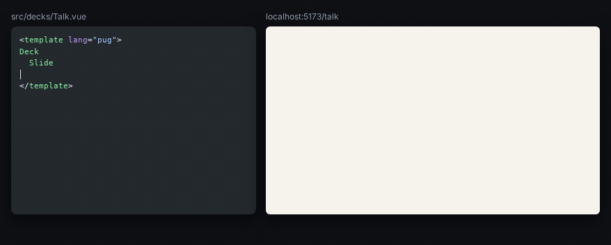
</p>

**Contents:** [Why Arao](#why-arao) · [Your first slide](#your-first-slide) · [Features](#features) ·
[Documentation](#documentation) · [License](#license)

## Why Arao

<table>
<tr>
<td>

Arao continues the idea of [eagle.js](https://github.com/Zulko/eagle.js): **a slideshow is a Vue
app, slides are components, and anything Vue can do, a slide can do.** eagle.js was built for
Vue 2 and is no longer maintained; Arao takes the same idea and rebuilds it for Vue 3 and Vite,
around a fixed canvas, absolute steps and themes made of tokens.

eagle.js had its bird; so does Arao. The *arao* is the **common guillemot**, a black-and-white
diving seabird of the **Cíes islands**, off Vigo.

</td>
</tr>
</table>

## Your first slide

```bash
npm install araojs vue && npm install -D vite && npm pkg set type=module
```

```js
// vite.config.js
import { defineConfig } from 'vite'
import arao from 'araojs/vite'
export default defineConfig({ plugins: [arao()] })
```

```js
// src/main.js
import { createDeckApp } from 'araojs'
createDeckApp().mount('#app')
```

```html
<!doctype html>
<!-- index.html -->
<div id="app"></div>
<script type="module" src="/src/main.js"></script>
```

```vue
<!-- src/decks/Hello.vue: a deck is one file -->
<template lang="pug">
Deck
  Slide(layout="cover")
    h1 Hello, Arao
</template>
```

```bash
npx vite    # open http://localhost:5173
```

Steps, code, themes, the PDF and every option: [Getting started](docs/getting-started.md).

## Features

<table>
<tr>
<td width="400">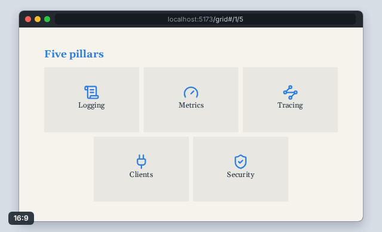</td>
<td width="340">

**One canvas, every screen**

A slide is drawn once, on a 1920x1080 canvas, and scaled whole to any window: it never
reflows, it letterboxes.

[Concepts](docs/guide/concepts.md#one-fixed-canvas)

</td>
</tr>
<tr>
<td width="340">

**Steps**

Reveal a slide one press at a time with `v-step`. The slide counts its own steps, and the URL
says where you are.

[Steps](docs/guide/steps.md)

</td>
<td width="400">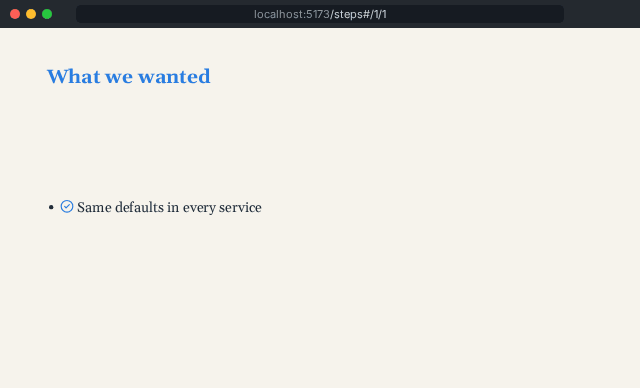</td>
</tr>
<tr>
<td width="400">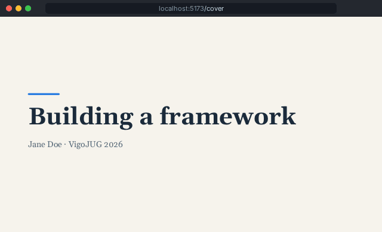</td>
<td width="340">

**Layouts and composition**

A cover, a split, a grid, a picture beside the text, a section: one prop or one component each,
no CSS.

[Layouts](docs/guide/slides-and-layouts.md) · [Composition](docs/guide/composition.md)

</td>
</tr>
<tr>
<td width="340">

**Code that walks itself**

A code window coloured by [Shiki](https://shiki.style/), from a file named in the slide. Each
step lights up its own lines or words.

[Code](docs/guide/code.md)

</td>
<td width="400">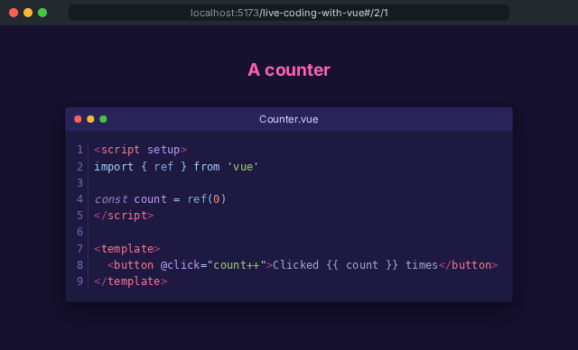</td>
</tr>
<tr>
<td width="400">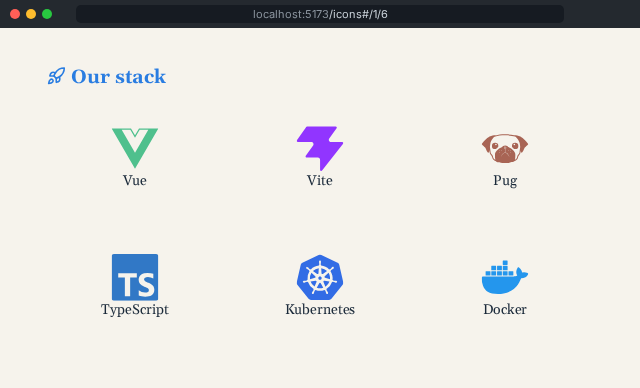</td>
<td width="340">

**Icons by name**

Any [Iconify](https://icon-sets.iconify.design/) icon or technology logo by its name, built in
and offline, in the theme's colours or the brand's own.

[Icons](docs/guide/icons.md)

</td>
</tr>
<tr>
<td width="340">

**Pictures and backgrounds**

Name a file of the images folder: a picture behind the slide, beside the text, or faded and
blurred under it.

[Images](docs/guide/images-and-backgrounds.md)

</td>
<td width="400">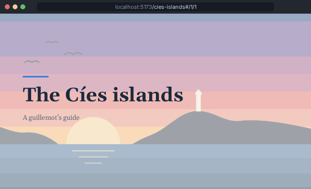</td>
</tr>
<tr>
<td width="400">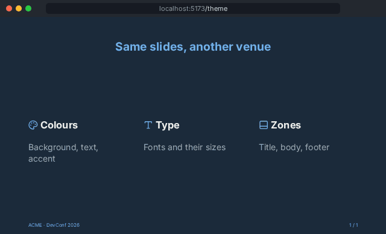</td>
<td width="340">

**Themes are tokens**

A theme is a handful of CSS variables. Press `t` and the same slides go to another venue.

[Themes](docs/guide/themes.md)

</td>
</tr>
<tr>
<td width="340">

**Presenter view**

Press `p`: the slide, what the next press shows, the notes of this step and a countdown, in
step with every window.

[Presenting](docs/guide/presenting.md#presenter-view)

</td>
<td width="400">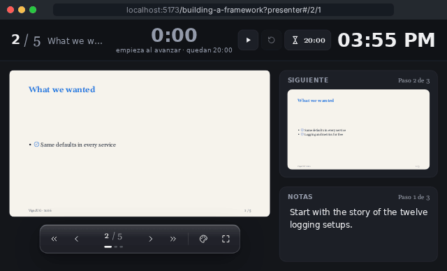</td>
</tr>
<tr>
<td width="400">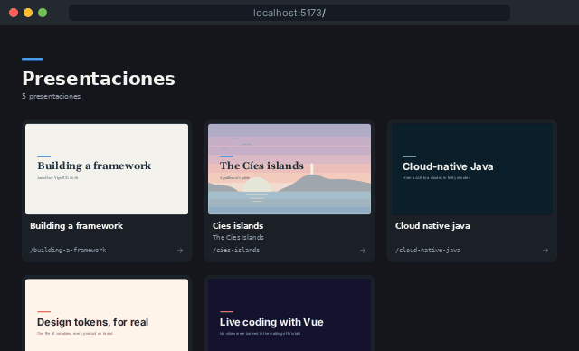</td>
<td width="340">

**All your talks in one project**

Keep every deck side by side, sharing components, code and pictures. Open the project and pick a talk by its cover.

[The project](docs/guide/project.md#the-list-of-decks)

</td>
</tr>
<tr>
<td width="340">

**Keyboard and touch**

Arrows to move, taps and swipes on a phone. Type a slide number and `Enter` to go straight
there, as in Keynote; or press `g` to search the slides by title and see where you are.

[Controls](docs/guide/presenting.md#controls)

</td>
<td width="400">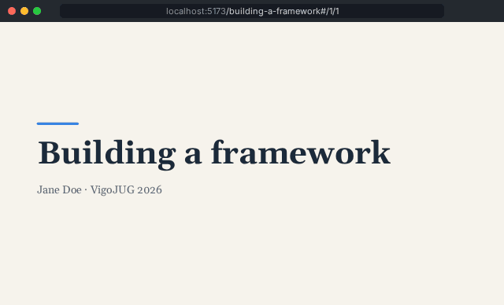</td>
</tr>
<tr>
<td width="400">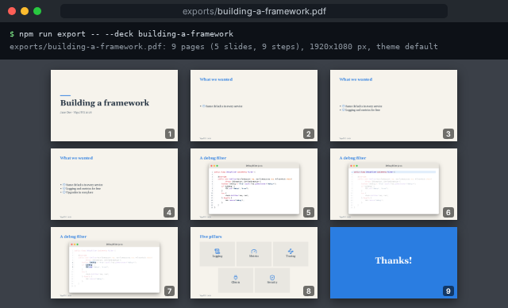</td>
<td width="340">

**PDF export**

One command, one PDF: a page per step (or per slide), text kept as text.

[Export](docs/guide/export.md)

</td>
</tr>
<tr>
<td width="340">

**Ready for your coding agent**

Write slides yourself, or ask your agent: Arao comes with a skill for coding agents. Install it,
and your agent writes and checks decks the Arao way.

[The Arao skill](skills/arao/)

</td>
<td width="400">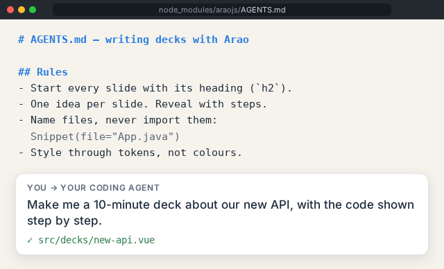</td>
</tr>
</table>

## Documentation

| | |
|---|---|
| [Getting started](docs/getting-started.md) | from an empty folder to a deck on the screen and in a PDF |
| [Guides](docs/index.md#guides) | layouts, steps, code, icons, themes, presenting, export, hosting, extending |
| [Reference](docs/index.md#reference) | every component, directive, composable, token, plugin option, CLI flag and URL |
| [The Arao skill](skills/arao/) | the skill for coding agents writing decks: rules, recipes, how to check a deck |
| [CONTRIBUTING.md](CONTRIBUTING.md) | developing, testing, documenting and releasing Arao |

## License

<table>
<tr>
<td>

**[Apache License 2.0](LICENSE)** · Copyright 2026 Ruben Pahino

<sub>Arao owes its starting idea to [eagle.js](https://github.com/Zulko/eagle.js), by Zulko and its
contributors: slides as Vue components. Icons come from the [Lucide](https://lucide.dev) and
[Simple Icons](https://simpleicons.org) sets through [Iconify](https://iconify.design), and code
colours from [Shiki](https://shiki.style/), each under its own licence.</sub>

</td>
</tr>
</table>
