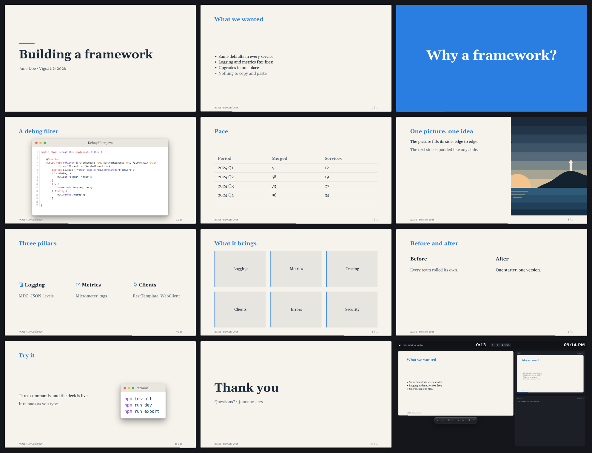
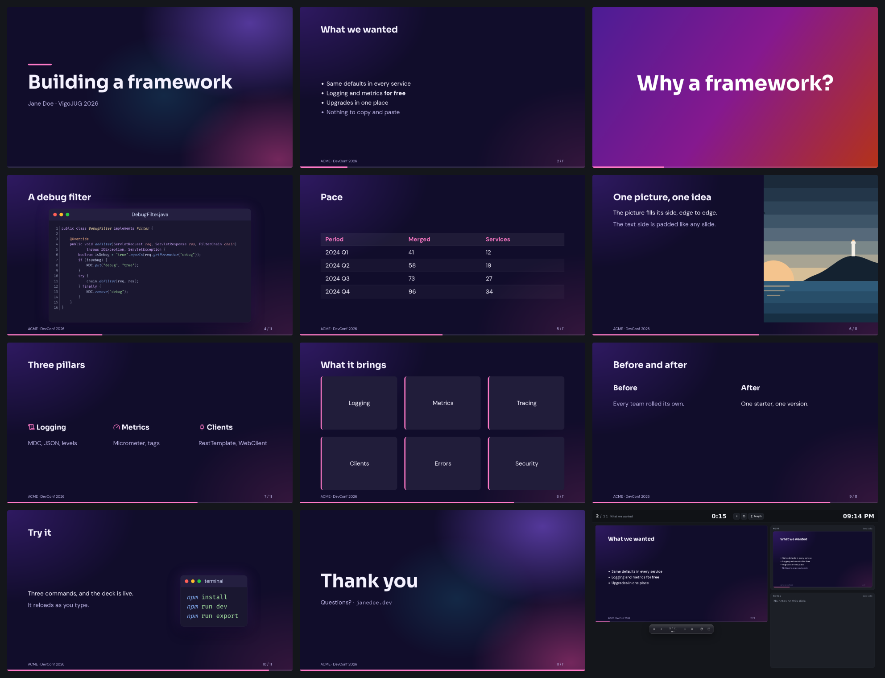
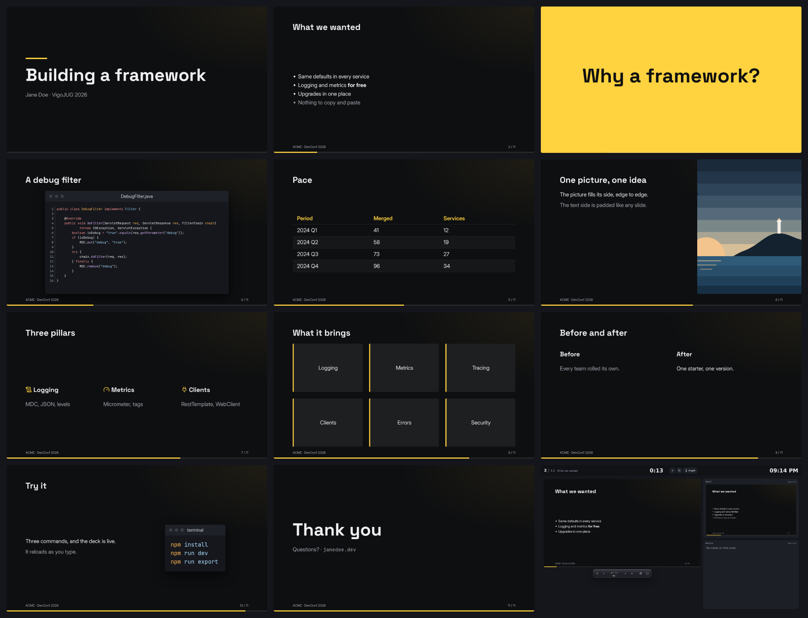
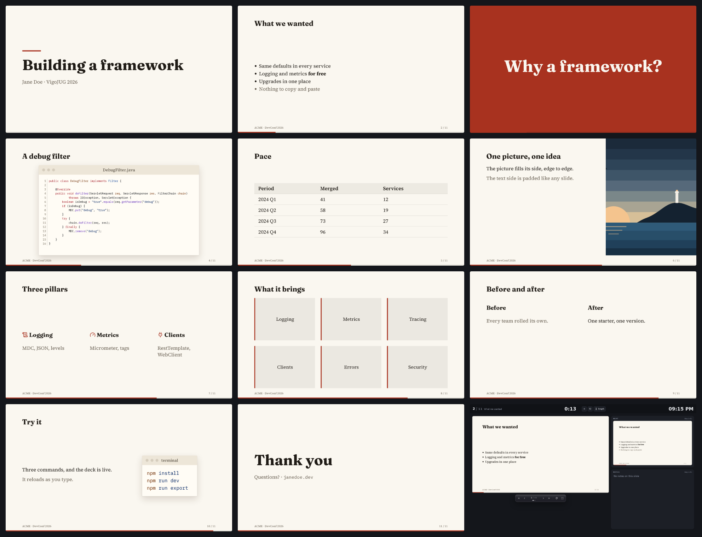
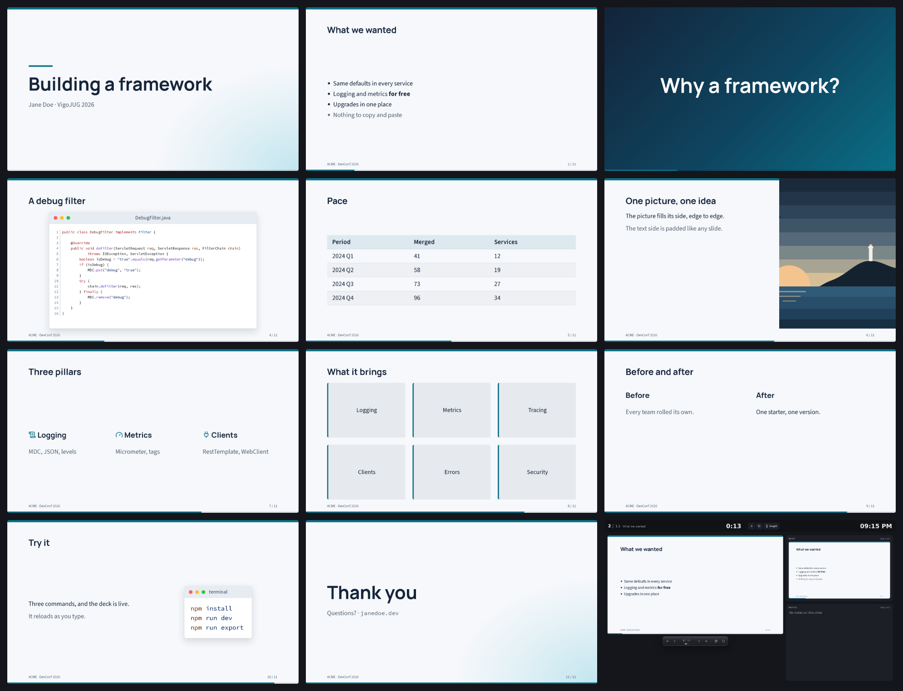
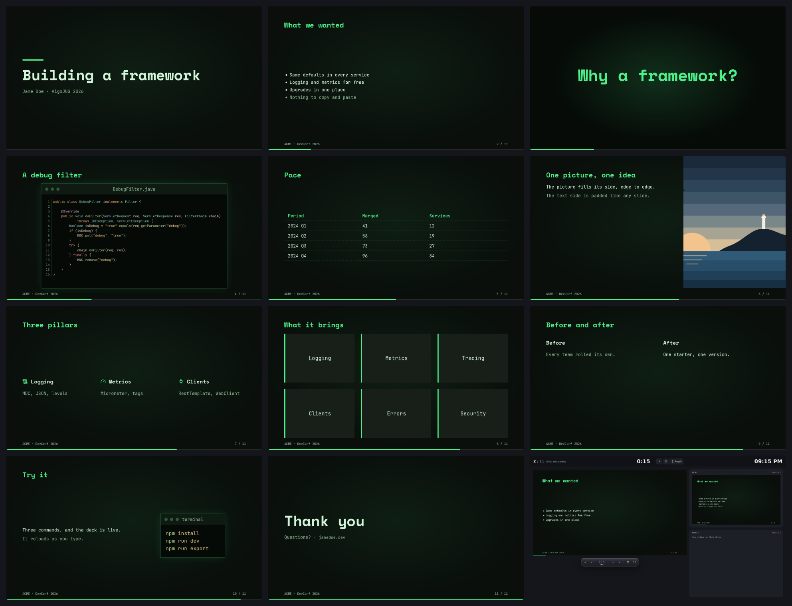

# Built-in themes

The library ships six themes, one CSS file each in its `themes/` folder: `default`, the engine's
defaults as they are, and five with a character of their own. That folder is a theme source like a
project's ([Where themes are found](themes.md#where-themes-are-found)): every deck can wear them,
with nothing to install, import or configure.

A deck without `themes` offers them all: `default` first, then the project's own, then these. A
deck that lists its themes picks among them by name, in its order:

```pug
Deck(:themes="['folio', 'carbon']")
```

`?theme=folio` opens a deck in one of its themes, and `t` (or the controls' picker) goes through
them while presenting. `arao export --theme folio` prints a deck in one.

Each theme names its fonts, a pairing for headings, text and code, and the build fetches them
([Fonts](themes.md#fonts)): weights 400, 600 and 700 only. With `fonts: false`, or offline, the text
falls back to the next fonts of each list (system fonts).

## Which ones load

All of them, by default. `arao({ builtinThemes })` in `vite.config.js` says otherwise:

```js
arao({ builtinThemes: ['folio', 'carbon'] })  // only these (and default)
arao({ builtinThemes: false })                // none but default
```

A built-in theme left out is not in the build at all: no CSS, no fonts, no name in the picker.
That matters for the fonts: together the five name thirteen families, and with all of them loaded
every build fetches and ships them (about 140 files, some 2.6 MB in `assets/_fonts`; a viewer's
browser downloads only the files of the theme on screen). A project whose decks wear their own
themes, or a couple of these, can keep the rest out. A name that is no built-in theme stops the
build.

Each sheet below is the same deck, `scripts/theme-sheets/Tour.vue`, in that theme: eleven slides
(a cover, a footer and bullets, a section, code, a table, a picture, columns, cards, two zones, a
small code window, a closing cover) and, last, the presenter view.

## default

The engine's defaults ([Theme tokens](../reference/theme-tokens.md)): a warm light page, Georgia, a
blue accent, a light code window. Its file names it and sets nothing, so that a project's own
`:root { --ar-accent: … }` still changes what `default` wears.

| Headings | Text | Code | Background | Text | Accent |
|---|---|---|---|---|---|
| Georgia | Georgia | the system's monospace (`github-light`) | `#f6f3ec` | `#1b2a3a` | `#2a7de1` |



## aurora

Vivid and dark: a deep indigo night lit by violet and pink glows, stronger on the cover; sections in
a violet-to-ember gradient; a hot pink accent, white titles. For a launch, a keynote, a talk that
wants some colour.

| Headings | Text | Code | Background | Text | Accent |
|---|---|---|---|---|---|
| Sora | DM Sans | Fira Code (`catppuccin-mocha`) | `#110d2b` | `#f5f2ff` | `#ff7ac8` |



## carbon

A dark keynote: near-black, white type, and one signal colour, yellow, kept for what matters (the
cover's bar, the progress, highlighted code, table heads, the section slides). Titles stay white.

| Headings | Text | Code | Background | Text | Accent |
|---|---|---|---|---|---|
| Space Grotesk | Inter | JetBrains Mono (`github-dark-high-contrast`) | `#0e0f11` | `#f1f1f3` | `#ffd23f` |



## folio

Editorial, on paper: a warm off-white page, ink-black text and titles, serif throughout as in print,
and one vermilion red for the details and the section openers; table heads on a light tint. Code
sits in a paper window, highlighted on a pale ochre, like a marker pen.

| Headings | Text | Code | Background | Text | Accent |
|---|---|---|---|---|---|
| Fraunces | Source Serif 4 | IBM Plex Mono (`github-light-high-contrast`) | `#faf7f0` | `#1f1b16` | `#a8321f` |



## meridian

Calm and corporate: a cool white page with a teal band along the top of each slide (and a soft teal
light in the cover's corner), navy titles, a quiet teal for the details, tables with a tinted head
and striped rows, sections in a navy-to-teal gradient.

| Headings | Text | Code | Background | Text | Accent |
|---|---|---|---|---|---|
| Manrope | Source Sans 3 | Source Code Pro (`github-light-high-contrast`) | `#f6f8fb` | `#14243a` | `#0a6f86` |



## terminal

A phosphor screen: green on near-black, monospace throughout, square corners, dashed table rules, a
faint glow in the middle of the screen; sections on a darker screen with the heading glowing; code
windows outlined in green, in Everforest's muted, greenish colours.

| Headings | Text | Code | Background | Text | Accent |
|---|---|---|---|---|---|
| Space Mono | JetBrains Mono | JetBrains Mono (`everforest-dark`) | `#0a0f0b` | `#d3f5d9` | `#4ef08a` |



## Contrast

Every text of the tour deck was measured against the pixels drawn behind it (gradients, glows and
code highlights included), at each slide's last step. The lowest ratio of each kind, WCAG 2 (AA asks
4.5:1 for text, 3:1 for large text such as titles):

| | default | aurora | carbon | folio | meridian | terminal |
|---|---|---|---|---|---|---|
| body text and tables | 11.5 | 14.6 | 14.6 | 13.9 | 12.8 | 14.2 |
| muted text | 4.9 | 8.7 | 7.9 | 5.9 | 5.6 | 7.9 |
| headings | 3.6 (large) | 14.1 | 16.8 | 16.0 | 14.7 | 12.2 |
| table head | 4.9 | 6.4 | 13.1 | 14.2 | 12.6 | 11.7 |
| footer | **3.2** | 5.2 | 7.9 | 5.1 | 4.7 | 8.4 |
| cover | 4.9 | 9.3 | 7.9 | 5.9 | 5.6 | 8.0 |
| section | 4.1 (large) | 7.2 | 13.2 | 6.2 | 8.2 | 9.6 |
| code | 6.5 | 8.2 | 10.3 | 10.0 | 10.2 | 9.9 |
| highlighted code | 4.9 | 4.7 | 6.0 | 7.3 | 7.3 | 5.2 |
| line numbers | **3.0** | 6.1 | 7.3 | 5.5 | 5.0 | 6.3 |
| code window title | 8.3 | 10.8 | 10.4 | 7.9 | 7.5 | 7.9 |

`default` is the defaults as they have always been: its footer, where a code window's shadow
reaches it, and its line numbers fall short of 4.5:1, and its blue titles and sections pass as large
text only.

What these numbers leave out:

- **Code colours the tour's code does not show**: every colour of each theme's code theme was
  checked against its code window and its highlight background too (`--ar-code-hl-bg`): the
  palest of all, code comments, keep 4.5:1 on a highlighted line or word in each of the five
  (not in `default`, whose `github-light` colours are below it even unhighlighted).
- **Dimmed lines** (the ones a highlight step leaves out) are faded on purpose, in every theme.
- **`SlideNumber` on a section slide** draws in the muted colour over the section's background, in
  every theme (`default` too): put the number in the deck's footer instead
  (`{{ number }} / {{ total }}`), which takes the section's text colour
  ([#68](https://github.com/rubasace/araojs/issues/68)).
- **What a deck draws itself** (pictures, its own colours) is the deck's.

## Your own on top

- **A look from one of them**: copy its file (`node_modules/araojs/themes/<name>.css`) into
  `src/themes/` and change what you like. Under another name the decks offer both; under the same
  name, yours replaces it.
- **The same name**: a project theme named like a built-in one (`[data-theme="folio"]` in
  `src/themes/`) replaces it. The built-in file is not loaded (nor its fonts), so yours looks
  exactly as it says, over the defaults, and keeps its place among the project's themes; Vite says
  so once. A project's own `default` replaces the built-in one, which sets nothing: it refines the
  defaults while a deck wears it.
- **The defaults**: a project's `:root { --ar-accent: … }` changes `default` (and every token a
  theme leaves alone), not what a built-in theme sets.
- **Only the project's themes**: `arao({ builtinThemes: false })` keeps the built-in ones out of the
  build; `Deck(:themes="['venue']")` keeps them out of one deck's list (they stay in the build).
