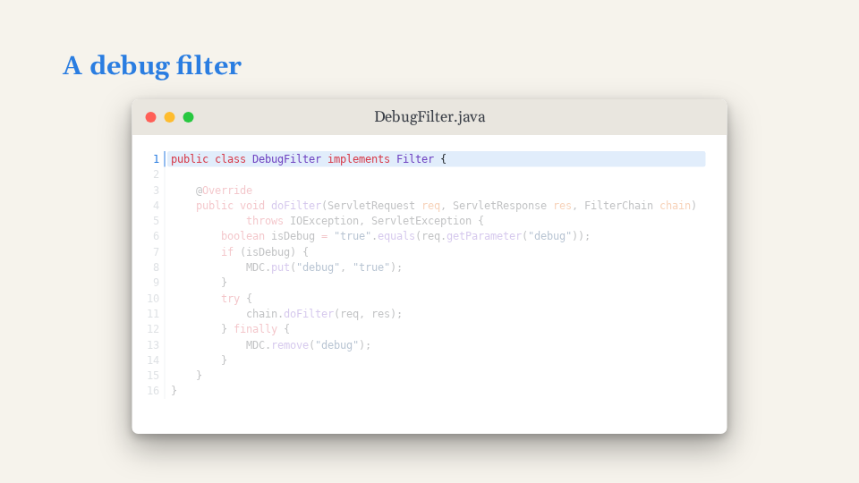
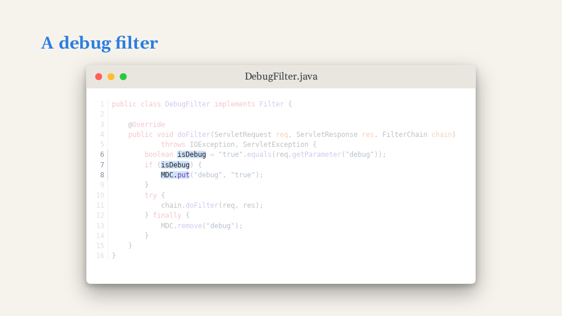

# Code

`Snippet` draws a code window: a macOS-style title bar, [Shiki](https://shiki.style/) colours,
line numbers, and line and word highlights per step. Files are named from the snippets folder
(`src/snippets`), never imported. Every prop: [Snippet](../reference/components.md#snippet).

<!-- example:snippet -->

```vue
<template lang="pug">
Deck
  Slide
    h2 A debug filter
    Snippet(file="DebugFilter.java" :highlights='{ "1": 2, "6-8:isDebug+++MDC.put": 3 }')
</template>
```

<!-- /example -->

| Step 2 | Step 3 |
|---|---|
|  |  |

**Frame and size.** Every snippet window has the slide's shape (`--ar-code-aspect`, 16/9) and is as
large as fits in the space it gets, up to `--ar-code-width` (1520 px): on a slide with a title that
is about 1396 x 785, the same on every full-slide snippet. In a column it keeps the shape, smaller.
Code sits top-left like an editor; `fit` makes the window hug the code instead. The font
is the theme's standard `--ar-code-size` on every slide; a snippet that would not fit at that size
shrinks to fit, never grows.

**Highlights.** Keys are a line spec, optionally followed by `:` and words separated by `+++`;
values are the step at which the rule applies.
- Lines: `"4"`, `"4-7"`, `"1,10-14"` (1-based).
- Words: `"2:implements Filter"`, `"8-10:isDebug+++MDC.put"`: on those lines only those words (every
  occurrence, plain substring match) are highlighted, the rest of the line is dimmed.
- At step `n`, the rules whose value is `n` highlight their lines/words and every other line is
  dimmed. Rules are **not cumulative**: each step shows only its own rules. A step with no rule
  shows the code plain.
- Step 1 always shows the code plain: a rule with value `1` never shows. Start at 2.
- The largest value counts as a step of the slide (`requireSteps`).

Gotchas: a missing file warns and shows `// missing snippet: <file>`. In this pod `monospace`
fonts may render proportional; that is the environment, not the engine.

```pug
Slide(title="A debug filter")
  h2 A debug filter
  Snippet(file="DebugFilter.java" :highlights='{ "2": 2, "8-10:isDebug+++MDC.put": 3 }')

Slide
  h2 Inline code
  Center
    Snippet(code="npm run export -- --deck demo" lang="bash" name="terminal" fit :line-numbers="false")
```
