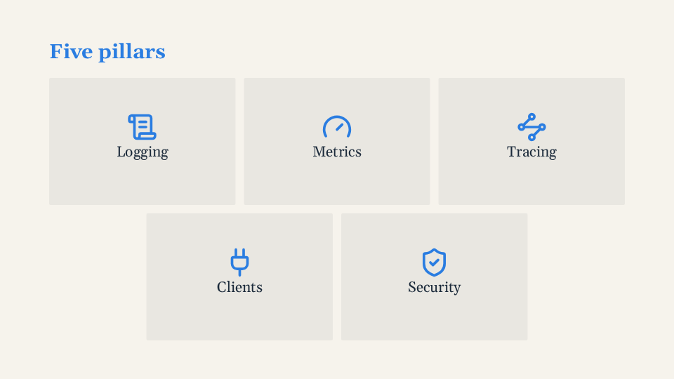

# Composition

`Cols`, `Rows`, `Grid` and `Center` arrange boxes by props (`ratio`, `gap`, `align`, `cols`):
no CSS needed. Each fills the free space of its container and takes `v-step` like any element.
Props and rules: [Cols, Rows, Grid, Center](../reference/components.md#cols-rows-grid-center).

<!-- example:grid -->

```vue
<template lang="pug">
Deck
  Slide
    h2 Five pillars
    Grid(ratio="2:1" gap="sm")
      Center.card(v-for="(p, i) in pillars" :key="p.icon" v-step="i + 1")
        Icon(:name="p.icon" size="88")
        p {{ p.name }}
</template>

<script setup>
const pillars = [
  { icon: 'lucide:scroll-text', name: 'Logging' },
  { icon: 'lucide:gauge', name: 'Metrics' },
  { icon: 'lucide:waypoints', name: 'Tracing' },
  { icon: 'lucide:plug', name: 'Clients' },
  { icon: 'lucide:shield-check', name: 'Security' },
]
</script>

<style scoped>
.card { background: color-mix(in srgb, var(--ar-fg) 6%, var(--ar-bg)); border-radius: var(--ar-radius); }
.card .ar-icon { color: var(--ar-accent); }
</style>
```

<!-- /example -->



`Grid(ratio="2:1")` lets the number of children decide the shape (columns : rows): 5 cards are
3 + 2, the last row centred.

```pug
Slide
  h2 Three pillars
  Cols(gap="lg")
    div
      h3 Logging
      p.muted MDC, JSON, levels
    div(v-step="2")
      h3 Metrics
    div(v-step="3")
      h3 Clients

Slide
  h2 Rows and Grid
  Rows(ratio="auto 1")
    p.muted Six things, in a 3-column grid
    Grid(cols="3" gap="sm")
      Center(v-for="n in 6" :key="n") Item {{ n }}
```

Uneven columns: `Cols(ratio="2 1")`. Centre something: `Center`. For one-off tweaks inside a
slide there are a few [utility classes](../reference/components.md#utility-classes).
