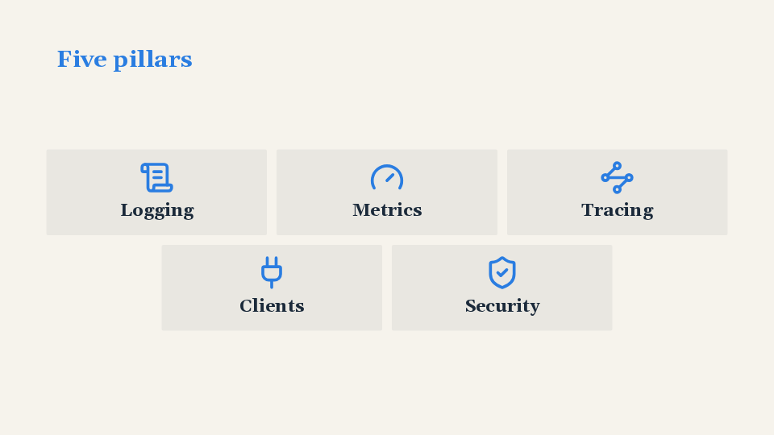
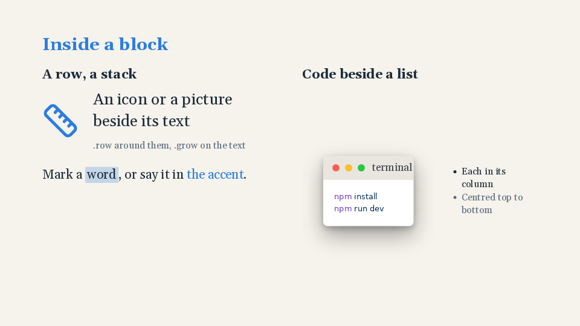

# Composition

Two levels, and no CSS at either. A slide's **structure** is its layout: two sides, a grid of
blocks, a picture beside the text ([Slides and layouts](slides-and-layouts.md)). **Inside a block**
(the body, a side of `split`, a block of `grid`, a zone) a few utility classes arrange and mark
things: an icon beside its text, a code block beside a list, a word marked. They read the theme's
tokens, so a theme restyles them.

The rule: when columns or rows are the whole slide, that is a layout. The classes are for what
goes inside one block. `npx arao layouts` lists both: every layout, then every class, each
described.

## The slide's structure: a layout

<!-- example:grid -->

```vue
<template lang="pug">
Deck
  Slide(layout="grid" cards="color-mix(in srgb, var(--ar-fg) 6%, var(--ar-bg))" icon-size="88px")
    h2 Five pillars
    div(v-for="(p, i) in pillars" :key="p.icon" v-step="i + 1")
      Icon(:name="p.icon")
      h3 {{ p.name }}
</template>

<script setup>
const pillars = [
  { icon: 'lucide:scroll-text', name: 'Logging' },
  { icon: 'lucide:gauge', name: 'Metrics' },
  { icon: 'lucide:waypoints', name: 'Tracing' },
  { icon: 'lucide:plug', name: 'Clients' },
  { icon: 'lucide:shield-check', name: 'Security' },
]
</script>
```

<!-- /example -->



`grid` balances its rows by the number of blocks: 5 are 3 + 2, the last row centred.

| The slide is | Its layout |
|---|---|
| two sides, side by side (before and after, text and code) | `split`; uneven: `columns="2fr 1fr"` |
| blocks in rows: features, pillars, a team, logos, cards | `grid`; `columns`, `rows`, `cards`, `icon-size`, `align`, `text-size` |
| columns of text | `Slide.top(layout="grid" align="start" text-size="1em")` |
| a picture beside the text | `image-left`, `image-right` |
| a picture and its caption | `caption` |
| text over a picture | `overlay` |
| a quote; one phrase or figure | `quote`; `statement` |
| one thing in the middle | `Slide.center`, or `statement` |

## Inside a block: utility classes

<!-- example:utilities -->

```vue
<template lang="pug">
Deck
  Slide(layout="split")
    h2 Inside a block
    div
      h3 A row, a stack
      .stack
        .row
          Icon.accent(name="lucide:ruler" size="120")
          .stack.gap-sm.grow
            p.text-lg An icon or a picture beside its text
            p.text-sm.muted .row around them, .grow on the text
        p Mark a #[span.highlight word], or say it in #[span.accent the accent].
    div(v-step="2")
      h3 Code beside a list
      .cols.grow.middle(style="--ar-cols: 3fr 2fr")
        Snippet(code="npm install\nnpm run dev" lang="bash" name="terminal" fit :line-numbers="false")
        ul.text-sm
          li Each in its column
          li.muted Centred top to bottom
</template>
```

<!-- /example -->



| Group | Classes |
|---|---|
| Placement | `cols` (one column per child; uneven: `style="--ar-cols: 2fr 1fr"`), `cols-2`, `cols-3`, `cols-4` (filled row by row), `rows` (`--ar-rows`), `stack`, `row` |
| Alignment | `top`, `middle`, `bottom`, `center` (both ways, its text too) |
| Spacing | `gap-sm`, `gap`, `gap-lg` |
| Size | `grow`, `text-sm`, `text-lg`, `text-xl` |
| Colour and marks | `accent`, `muted`, `highlight`, `upper` |

Each one, and the classes of a `Slide` itself (`top`, `middle`, `center`, `bottom`,
`no-footer`, `with-footer`): [Utility classes](../reference/components.md#utility-classes).

- A placement class is as tall as its content; `grow` makes it fill the rest of its container. A
  `Snippet`, or an `Img` that should fill, needs that box: `.cols.grow` around them.
- Put the placement classes on an element of yours inside the block: a layout lays out its own
  blocks (a `.row` written on a side of `split` stays a column). Gaps, sizes and colours work on a
  layout's blocks too, and so does alignment on a side of `split` or a zone (`div.middle` as a
  side). A block of `grid` takes `.top`, `.middle` and `.bottom` (top to bottom), but across it
  follows grid's `align` parameter: `.center` there centres top to bottom only.
- In columns and rows a child is never wider than its track: what is wider is clipped at its edge,
  never painted over its neighbour. A child collapsed by `v-step.collapse` frees its track.
- `--ar-cols` and `--ar-rows` are CSS grid tracks, taken as written: write whole `fr`
  (`3fr 2fr`); `fr` that add up to less than 1 fill only that part (`.3fr .2fr` fills half).
- The sizes, colours, the marker and `.upper` are `!important`: they win over what a layout or a
  theme sets on the same element (`p.accent` in a block of `grid` is the accent, though the
  block's text is muted), and over an inline `style="color: …"` on the same element. They reach
  the children only by inheritance, so a child's own colour still shows (`Agenda.muted`: each
  item keeps its state's colour, set on the item). A theme changes them through their tokens
  (`--ar-accent`, `--ar-muted`,
  `--ar-text-small`/`-large`/`-xlarge`, `--ar-highlight`), not by overriding the classes.
- The names are short and common, and apply to any element inside a slide: a class of the same
  name from somewhere else (`.row` or `.stack` of Bootstrap or daisyUI, Tailwind's `text-*`,
  Pygments' `.highlight` around code pasted as HTML) gets their style there too. An accepted
  trade-off, for names an author can type and an agent can guess; outside the slides (the
  presenter view, the list of decks) nothing is touched.

## When it does not fit

The canvas has a fixed size, so too much on a slide does not scroll: it is cut off at the bottom,
hidden under the footer, or pushed past the side. Arao measures what each slide shows, on the
1920x1080 canvas (whatever the size of the window), and says what overflows:

- **In development** (`npm run dev`), a console warning for the slide on screen, a moment after it
  settles, at each step you show: the deck, the slide's number and title, its step, what overflows
  and by how many px, and how to fix it.

  ```
  [arao] overflow: deck "mytalk", slide 7 "Twelve pillars", step 3 of 4: the body overflows by
  46px at the bottom, under the footer. To fit it: Slide.fit (shrinks the body's text just
  enough), a .scale-90, .scale-80 or .scale-70 class on the slide or on a block, or fewer blocks.
  ```

  Once per slide and step: the same overflow is not said again; a different one (after an edit)
  is.
- **In `arao export`**, every page (every step, or with `--per-slide` each slide at its last
  step) is measured as it is printed, and the slides that overflow are listed at the end of the
  run, with the same words. A warning: the PDF is written and the exit code stays 0, unless
  `--strict` ([CLI](../reference/cli.md#arao-export)).
- The Arao skill's headless check (its `check-deck` script) walks every step and reports the same
  warnings. It reads them from the dev server's page: run it against `npm run dev`, not against a
  production build, which says nothing (below).

What is measured: the slide's header, body and zones against the space they have (the body, under
the title, above the footer's band), each block of a layout (a side of `split`, a block of `grid`,
a paragraph too wide) against its own box, and whatever clips (the columns of `.cols`) against its
own. What is meant to reach past its box is not: a `Background`, an element positioned absolutely
(a decoration placed by hand), the inside of an `Img`, a `Snippet` or an `Icon`, a step not shown
yet, and anything marked `data-ar-bleed` (a picture you pull out to the slide's edge with negative
margins):

```pug
Img(file="skyline.jpg" data-ar-bleed style="margin: 0 calc(-1 * var(--ar-pad-x))")
```

In a production build (the site you host, `npm run build`) nothing is measured: only `Slide.fit`
works there, on the slides that have it.

The fix the warning gives follows where it overflows. Past the bottom or the right, the content is
too much for the slide: fit it, scale it, or cut. Past the top or the left alone, it was put there
(a negative margin, a transform): shrinking does not bring it back, and the warning says to mark it
(`position: absolute`, `data-ar-bleed`) if it is meant to reach out, or to move it back in.
(Centred content too wide spills on both sides: that is too much, like the bottom and the right.)

The fixes, from the least to the most:

- **`Slide.fit`**: the body's text shrinks just enough to fit, and everything in it sized in `em`
  with it (a list's gaps, a grid's pictures); the layout reflows, nothing is stretched. Down to
  60% of its size: past that it stays at 60% and the warning says so (split the slide). It fits
  what spills at the bottom and on the right, and only as far as shrinking helps: content sized in
  px (a block 2200px wide) or transformed does not shrink with the text, so for it the body stays
  whole and the warning says that `fit` cannot shrink it. It is measured again whenever the
  content, the step, the theme or the window changes, and in the export before each page is taken.
  A slide without `fit` is never resized. With `v-step.collapse`
  each step is fitted as it shows, so the text gets smaller as steps add to it; `v-step` keeps the
  space of what is still to come, and the text the same size at every step.
- **`.scale-90`, `.scale-80`, `.scale-70`**: a fixed step down, on the slide (its body) or on one
  block (a side of `split`, a card), when you would rather choose the size.
- **Fewer blocks**, less text, or two slides.

```pug
Slide.fit
  h2 Everything we shipped this year
  ul
    li(v-for="item in shipped") {{ item }}

Slide(layout="split")
  h2 Before and after
  div.scale-80
    ul
      li …
  div
    p …
```

Sizes in px, and those taken from the title's tokens (a side of `split`'s heading, an `h2` in the
body), do not follow `fit` or a scale: only what is in `em`, which is most of what a slide shows.
On a slide, `fit` and the scales set the body's font-size from the slide's: a font-size a layout
of your own sets on `.ar-body` gives way to them. A layout that wants another text size sets it on
the slide (`.layout-x { font-size: 1.1em }`): the body inherits it, and `fit` and the scales start
from it.
A `grid` makes its blocks smaller by itself as they grow in number (pictures, padding, gap and
text step down from 9, 11, 12 and 16 blocks), so that up to 20 fit with a title and a one-line
description each.

## From Cols, Rows, Grid and Center

These four components are gone: a slide's columns are a layout, and what was inside a block is a
class.

| Before | Now |
|---|---|
| `Cols` of two sides, the whole slide | `Slide(layout="split")`, a `div` per side; `ratio="2 1"` → `columns="2fr 1fr"`; `gap` → `gap="…"` |
| `Cols` of three or more columns of text, the whole slide | `Slide.top(layout="grid" align="start" text-size="1em")`, a `div` per column: `.top` keeps them under the title (grid centres its rows otherwise), `text-size="1em"` keeps the slide's text size (a block's `p` is a small caption otherwise) |
| `Cols` of three or more blocks with an icon or a picture, the whole slide | `Slide(layout="grid")`, a `div` per block (an icon, an `h3`, a `p`) |
| `Grid(cols="3")` / `Grid(ratio="2:1")` of cards or icons, the whole slide | `Slide(layout="grid")` (rows balanced by count, last one centred); `columns="3"`; `cards="…"` for a background; an icon's `size` → `icon-size="140px"` |
| `Cols` inside a block | `.cols`; `ratio="2 1"` → `style="--ar-cols: 2fr 1fr"` (whole `fr`: shares were proportions, `fr` that add up to less than 1 fill only that part: `.3fr .2fr` fills half) |
| `Grid(cols="3")` inside a block | `.cols-3` (`cols-2`, `cols-4`) |
| `Rows(ratio="auto 1")` | `.stack` with `.grow` on what fills, or `.rows(style="--ar-rows: auto 1fr")` with a height (`.grow`) |
| `Center` | `.center.grow`: `Center` filled the space left, `.grow` does that (in a cell of `.cols` it fills anyway); around a picture with a size, `.stack.center.grow`; around a `Snippet`, nothing (it fills and centres its window) |
| `align="start"` / `"center"` / `"end"` | `.top` / `.middle` / `.bottom` on the columns (or on a side of `split`) |
| `gap="sm"` / `"md"` / `"lg"` | `.gap-sm` / `.gap` / `.gap-lg` (the classes' gap is `md`) |
| `.small` | `.text-sm` |
