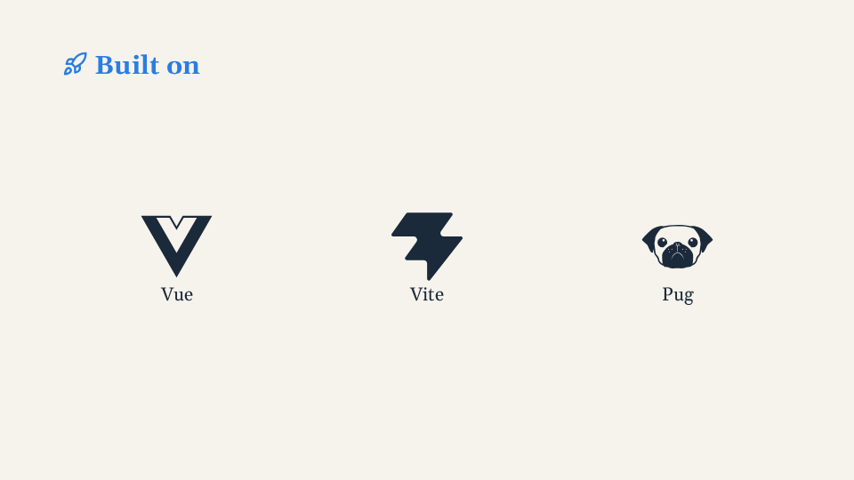

# Icons

`Icon(name="lucide:rocket")` draws any [Iconify](https://icon-sets.iconify.design/) icon by
name, resolved when the project is built or served: nothing is fetched when presenting, and they
are vectors in the PDF. Use Lucide for UI icons and Simple Icons for technology logos; don't put
icon files in `src/images` or paste SVG into a deck. Every prop:
[Icon](../reference/components.md#icon).

<!-- example:icons -->

```vue
<template lang="pug">
Deck
  Slide
    h2 #[Icon(name="lucide:rocket")] Built on
    Grid(cols="3" gap="md")
      Center(v-for="(t, i) in tech" :key="t.icon" v-step="i + 1")
        Icon(:name="t.icon" size="160" :label="t.label")
        p {{ t.label }}
</template>

<script setup>
const tech = [
  { icon: 'simple-icons:vuedotjs', label: 'Vue' },
  { icon: 'simple-icons:vite', label: 'Vite' },
  { icon: 'simple-icons:pug', label: 'Pug' },
]
</script>
```

<!-- /example -->



```pug
h2 #[Icon(name="lucide:rocket")] Launch
p #[Icon.hot(name="lucide:flame")] The hot path
Icon(name="simple-icons:kubernetes" size="120" label="Kubernetes")
Grid(cols="4" gap="md")
  Icon(v-for="it in items" :key="it.icon" :name="it.icon" size="96")
```

(`.hot { color: var(--ar-accent); }` in the deck's `<style scoped>`; `items` lists the names in the
deck's script: `[{ icon: 'lucide:gauge' }, …]`.)

## Sets

`lucide` (UI icons, [lucide.dev](https://lucide.dev)) and `simple-icons` (logos of
technologies and brands, [simpleicons.org](https://simpleicons.org)) come with the library. Any
other Iconify set works once the slides project installs its package,
`npm install -D @iconify-json/<prefix>` (`@iconify-json/mdi`, `@iconify-json/logos`, …: the prefix is
the one in the set's address on icon-sets.iconify.design). A set installed in the project wins over
the library's copy of the same set, so a project can pin another version of Lucide.

## How icons get in

The Vite plugin reads the project's source (`src/` and the decks folder;
`.vue .pug .js .ts .jsx .tsx .mjs .cjs` files; not the snippets and images folders) for words of the
form `prefix:name` that are icons of an installed set, and builds only those into the app, through
the module `virtual:arao/icons`. A static `name="…"` is found, and so are names written in data
(`{ icon: 'lucide:rocket' }`) and bound with `:name`. During development, a name written in a
saved file shows at once, without a restart; a set installed while the dev server runs is found at
the next save of a file that uses it.
- **Limitation:** a name put together at runtime (`` :name="`lucide:${kind}`" ``, a value from a
  fetch) is not in the source, so it is not built in. Write the full names somewhere in the source
  (a list of them is enough), or force them with the plugin option
  `arao({ icons: ['lucide:sun', 'lucide:moon'] })` ([Vite plugin](../reference/vite-plugin.md)).
- A word that looks like a name but is no icon (`localhost:5173`, `a:hover`) is ignored; a real
  name in a comment or in text is built in too (it only costs its few hundred bytes).

## Look

The colour is `currentColor`: the icon takes the colour of the text, and is styled like
text (`color: var(--ar-accent)`). Multicolour sets keep their own colours. It is `1em` tall by
default, so it follows the font size where it sits (in a heading it is as tall as the heading's
text; a class with `font-size` resizes it); `size` sets px. It sits on the text's baseline like a
glyph and never shrinks in a flex row. Width and height are SVG attributes, so a CSS rule with
`width`/`height` wins over them. Classes: `.ar-icon` (the `svg`), `.ar-icon-missing`.

## Missing icon

A name that is not in the build (its set is not installed, a typo, a name built
at runtime) shows an empty dashed box of the same size, so nothing around it moves, and one warning
per name in development: `[arao] Icon "foo:bar" not found: …`, which says to install
`@iconify-json/foo` or to check the name.

## Licences

Icons are others' work, under their own licences: check a set's licence on
icon-sets.iconify.design before using it in a talk you publish.
- Lucide: ISC (free to use; nothing to show on the slides).
- Simple Icons: CC0 for the drawings, but the logos are trademarks of their owners. Use them to
  refer to the technology or the brand, not as decoration or to suggest endorsement. Some brands
  are left out at their owner's request (Java: `simple-icons:openjdk` is the closest).
- Some sets require attribution, such as Font Awesome Free (CC BY 4.0): credit them, on a closing
  slide for instance.
