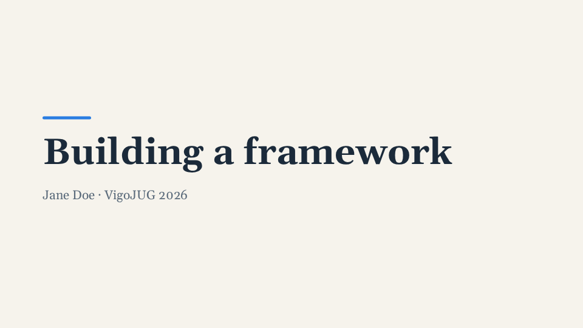
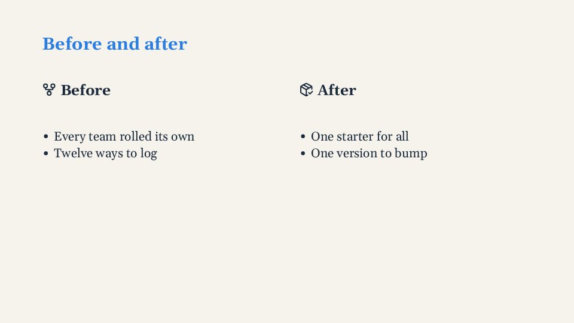

# Slides and layouts

A slide is a `Slide` inside the `Deck`. Its `layout` decides how its content is arranged; inside
a content slide, the header, the body and the footer find their own place. Every prop and slot:
[Slide](../reference/components.md#slide).

## Layouts

`default` (a content slide), `cover`, `section`, `split` (a header over two named zones) and
`image-left` / `image-right` (an edge-to-edge picture beside the text), with `ratio="3 2"` for
the zones' widths. The full table: [Layouts](../reference/components.md#layouts).

A cover:

<!-- example:cover -->

```vue
<template lang="pug">
Deck
  Slide(layout="cover")
    .bar
    h1 Building a framework
    p.muted Jane Doe · VigoJUG 2026
</template>
```

<!-- /example -->



A split slide, its right side revealed at step 2:

<!-- example:split -->

```vue
<template lang="pug">
Deck
  Slide(layout="split")
    h2 Before and after
    template(#left)
      h3 #[Icon(name="lucide:git-fork")] Before
      ul
        li Every team rolled its own
        li Twelve ways to log
    template(#right)
      h3(v-step="2") #[Icon(name="lucide:package-check")] After
      ul(v-step="2")
        li One starter for all
        li One version to bump
</template>
```

<!-- /example -->



A picture beside the text, and a section divider:

```pug
Slide(layout="image-right" ratio="3 2")
  template(#image)
    Img(file="demo/landscape.svg" alt="A landscape")
  h2 One picture, one idea
  p The picture fills its side edge to edge.

Slide(layout="section")
  h1 Why a framework?
```

## Zones: header, body, footer

A slide of the `default` layout (or of any layout name without zones of its own) is laid out in
three zones. Nothing to declare: the slide finds them.

```pug
Slide
  h2 Three pillars        //- header: the heading the slide starts with
  Cols(gap="lg")          //- body: everything else
    div …
```

- **Header**: when the default slot starts with an `h1` or `h2`, that heading is the slide's title
  and goes into the header; headings right after it go there too (a subtitle, or one title per
  step: `h2(v-step.only.collapse="1") …`, `h2(v-step.only.collapse="2") …`). Comments, `v-if`s
  that render nothing and `Notes` before it do not count. A `#title` slot, when given, is the
  header instead, for headers with more than a heading (a kicker line, a logo); its first `h1`/`h2`
  is the title. A slide that starts with anything else has no header: the body takes the slide.
  The title carries the class `ar-title` and follows the `--ar-title-*` tokens; with
  `--ar-header-height` the header is a band of that height with the title centred in it
  ([Theme tokens](../reference/theme-tokens.md#slide-zones-and-content)).
- **Body**: everything else, in a column that fills the space between the header and the footer.
  `align` (or the theme's `--ar-body-align`, `center` unless the theme says otherwise) places it:
  `start` (from the top), `center`, `end`. What does not fit overflows at the bottom, never at the
  top. What fills the body still fills it whatever the alignment: `Img`, `Snippet`, an element with
  `flex: 1`, the `1fr` rows of `Grid` and `Rows`. `Cols`, `Rows` and `Grid` placed directly in a
  centred (or end-aligned) body shrink their auto rows to their content and centre them, unless
  they hold something that needs the full height (a `Snippet`, an `Img`, another piece): then
  they fill as in a `start` body. `Cols(align="stretch")`, written out, keeps full-height columns.
  `.collapse` steps in a centred body move the rest as they come and go (it is re-centred).
- **Footer**: the `Deck`'s `#footer` slot, in a band `--ar-footer-height` tall (88 px) at the
  bottom of the slide, with the slide's side padding and its text in `--ar-footer-size` and
  `--ar-footer-color`. Its children sit in a row, spread by `--ar-footer-align` (`space-between`:
  one at the start, two at both ends). The band takes the place of the slide's bottom padding, so
  the body (and the zones of `split` and `image-*`) ends where the footer begins. Hidden on `cover`
  and `section` unless `:footer="true"`; there it sits over the bottom padding, and on a section it
  takes the section's text colour unless the theme sets `--ar-footer-color` for `.layout-section`.
  `Slide(:footer="false")` hides it on one slide.
- `SlideNumber` keeps its corner (bottom right, on the footer band's line with the default
  height), outside the footer's content box. To have the number inside the footer, use the slot
  props (`{{ number }} / {{ total }}`) instead of `SlideNumber`.

```pug
Slide(align="start")      //- this slide's body from the top
  h2 A long list
  ul …

Slide(:footer="false")    //- no footer here (a full-bleed picture, say)
  …
```

The deck's footer, with the slide number, written once in `Deck`:

```pug
Deck
  template(#footer="{ number, total }")
    span ACME · DevConf 2026
    span {{ number }} / {{ total }}

  Slide(layout="cover" :footer="true")
    h1 Shown on this cover too
  Slide(:footer="false")
    h2 Not on this one
```

## Lists and tables

- Lists: `--ar-list-gap` is the space between items (default `0`).
- Tables get a plain style from tokens: full width, collapsed borders, cells padded
  `--ar-table-pad`, a line `--ar-table-border` under every row, header cells in
  `--ar-table-head-color` on `--ar-table-head-bg`, every other body row on `--ar-table-stripe`.
  These rules have zero specificity: any rule of the deck (`.my-table td { … }`) wins.

```pug
Slide
  h2 Pace
  table
    thead
      tr
        th Period
        th Merged
    tbody
      tr
        td September
        td 32
      tr
        td October
        td 59
```
