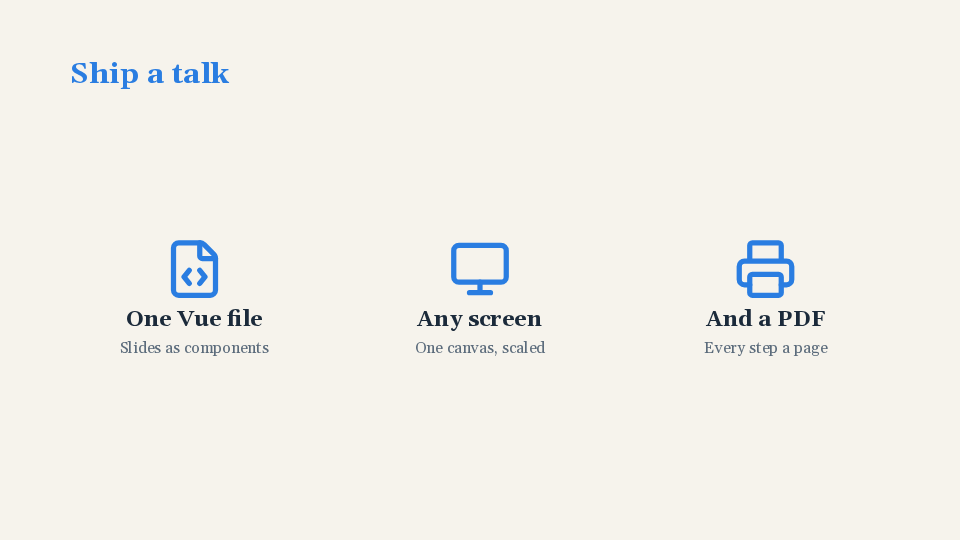
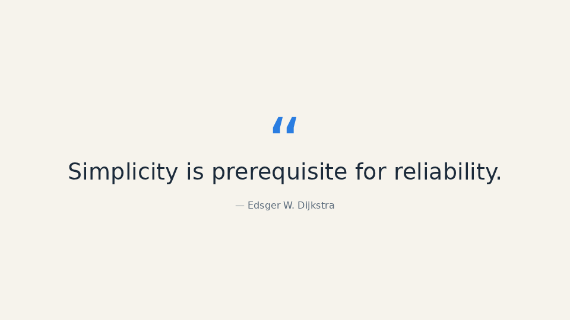
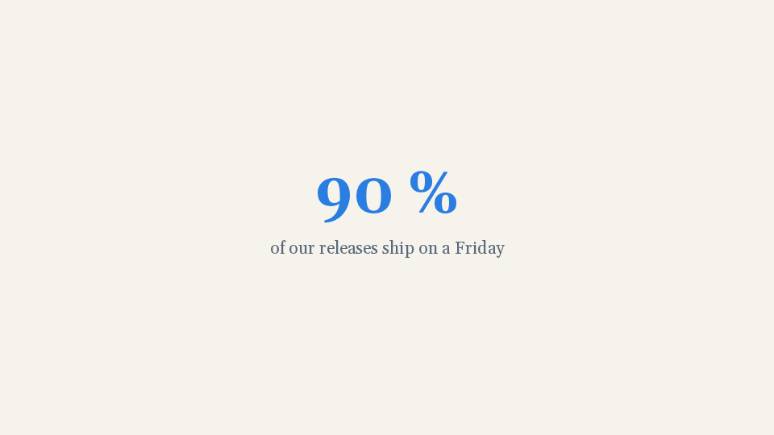
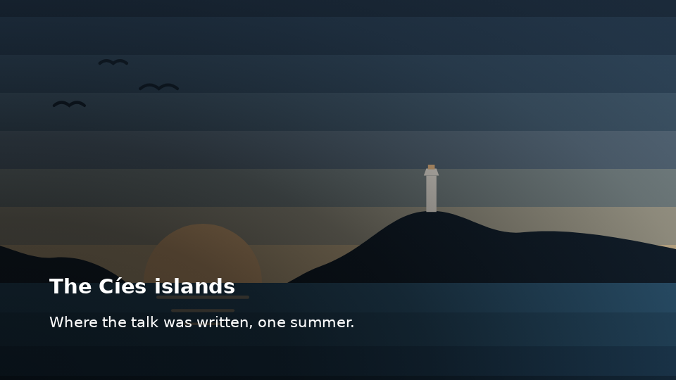
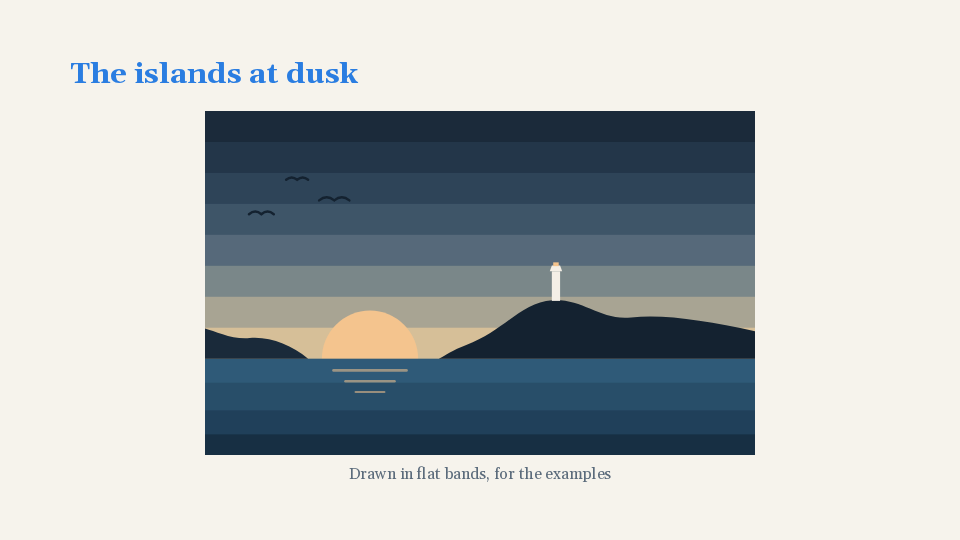
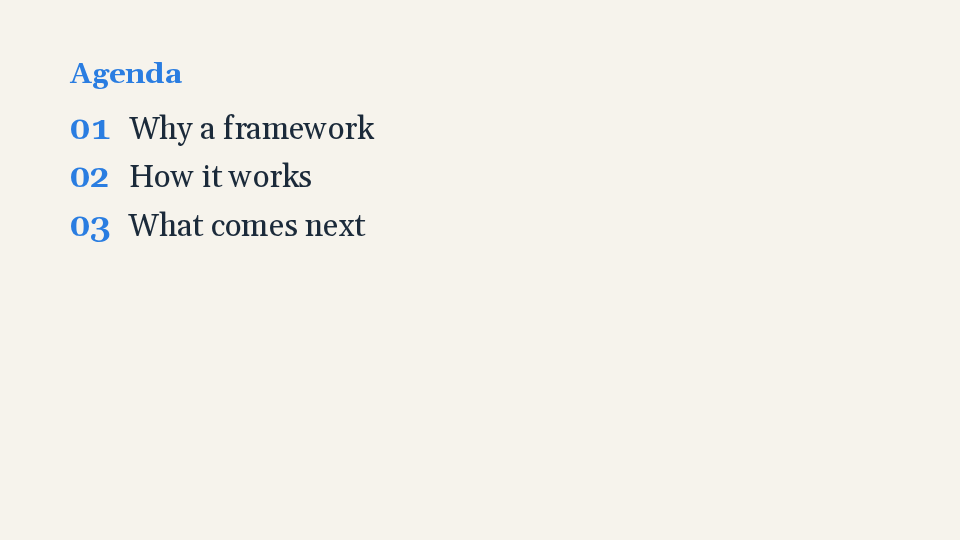

# Slides and layouts

A slide is a `Slide` inside the `Deck`. Its one prop, `layout`, names a layout: CSS that
arranges the slide's parts (the header, the body, the zones of its named templates, the footer).
Every slide finds those parts the same way, whatever its layout. The layout's tokens are the
slide's attributes too ([Layout parameters](#layout-parameters)). Every prop and slot:
[Slide](../reference/components.md#slide).

## Layouts

`default` (a content slide), `cover`, `section`, `split` (two sides under the title), `grid`
(blocks in balanced rows: features, pillars, logos), `quote`, `statement` (one phrase or figure,
huge), `overlay` (text over a full-slide `Background`), `caption` (one picture and its caption),
`agenda` (the talk's parts, with [`Agenda`](../reference/components.md#agenda)) and `image-left` /
`image-right` (a full-height, edge-to-edge picture beside the text). Each is one CSS file of the
library; the full table, and the tokens each one reads:
[Layouts](../reference/components.md#layouts). A name with no CSS behind it is the `default`
layout, its slides carrying the class `layout-<name>` for a theme or a deck to style. In a
TypeScript project the editor completes the names there are, each layout's parameters and zones,
shows each one's doc on hover, and `vue-tsc` turns down any other
([Layouts in the editor](#layouts-in-the-editor)).

Every layout documents itself, the library's and the project's alike: what it is for, an example,
its zones and its parameters. `npx arao layouts` prints them all, for the layouts the project has
(`--json` for a program: [CLI](../reference/cli.md#arao-layouts)). A layout reads plain HTML, and
its doc block says which: the semantic form (a `blockquote` and its `cite`, a `figure` and its
`figcaption`), and, where it takes one, the plain form it tolerates too (two `p`, an `Img` then a
`p`), so that writing simply never breaks it. No layout needs a named template but `image-*`.

A cover:

<!-- example:cover -->

```vue
<template lang="pug">
Deck
  Slide(layout="cover")
    .bar
    h1 Building a framework
    p.muted Jane Doe · DevConf 2026
</template>
```

<!-- /example -->


A split slide: the body's two children are its two sides, each with its own `h3`; the right side
revealed at step 2 (`columns`, `gap` and `divider`, a border between them, tune it):

<!-- example:split -->

```vue
<template lang="pug">
Deck
  Slide(layout="split")
    h2 Before and after
    div
      h3 #[Icon(name="lucide:git-fork")] Before
      ul
        li Every team rolled its own
        li Twelve ways to log
    div(v-step="2")
      h3 #[Icon(name="lucide:package-check")] After
      ul
        li One starter for all
        li One version to bump
</template>
```

<!-- /example -->


A picture beside the text, and a section divider:

```pug
Slide(layout="image-right")
  template(#image)
    Img(file="demo/landscape.svg" alt="A landscape")
  h2 One picture, one idea
  p The picture fills its side, top to bottom, edge to edge.

Slide(layout="section")
  h1 Why a framework?
```

A grid of blocks: each child of the body is a block (a picture or an `Icon` first, drawn at one
size, then its `h3` and a muted `p`), in rows balanced by how many there are (4 as 2 + 2, 5 as
3 + 2, 7 as 4 + 3, 9 as 3 + 3 + 3…), the last one centred; `columns="4"` fixes the count,
`rows="2"` the rows, `cards` gives each block a background, `align="start"` lines their content
up on the left. A block's parts are found at any depth in it (a link around them, a component of
your own), its picture when it comes first. Past
eight blocks, keep each short (an icon and a title): the pictures get smaller from nine on, but
three rows of three lines each fill a slide.

<!-- example:features -->

```vue
<template lang="pug">
Deck
  Slide(layout="grid")
    h2 Ship a talk
    div
      Icon(name="lucide:file-code")
      h3 One Vue file
      p Slides as components
    div
      Icon(name="lucide:monitor")
      h3 Any screen
      p One canvas, scaled
    div
      Icon(name="lucide:printer")
      h3 And a PDF
      p Every step a page
</template>
```

<!-- /example -->



A quotation (two `p`, the quote then its author, work too) and a statement, a phrase or a figure
that is the slide (a `p` first works too, without a name in the jump menu):

<!-- example:quote -->

```vue
<template lang="pug">
Deck
  Slide(layout="quote")
    blockquote Simplicity is prerequisite for reliability.
    cite Edsger W. Dijkstra
</template>
```

<!-- /example -->



<!-- example:statement -->

```vue
<template lang="pug">
Deck
  Slide(layout="statement")
    h2 90 %
    p of our releases ship on a Friday
</template>
```

<!-- /example -->



Text over a picture (`position="start end"` puts it top right; `scrim` is the gradient behind it),
and one picture with its caption (an `Img` followed by a `p` works too):

<!-- example:overlay -->

```vue
<template lang="pug">
Deck
  Slide(layout="overlay")
    Background(src="cies.svg")
    h2 The Cíes islands
    p Where the talk was written, one summer.
</template>
```

<!-- /example -->



<!-- example:caption -->

```vue
<template lang="pug">
Deck
  Slide(layout="caption")
    h2 The islands at dusk
    figure
      Img(file="cies.svg" alt="The Cíes islands at dusk")
      figcaption Drawn in flat bands, for the examples
</template>
```

<!-- /example -->



### The agenda

`Agenda`, inside a slide, is an ordered list of the titles of the deck's `section` slides, kept
up to date by the deck. On an `agenda` slide its rows are big and numbered, and each shows where
the talk stands from that slide: the parts already given dimmed (`done`), the next one in the
accent, bold (`current`), the ones after it as they are (`upcoming`). Write it once after each
section, or on every section slide (the section itself is then the current one), and each copy
shows the talk's progress; in the presenter view and the export too.

<!-- example:agenda -->

```vue
<template lang="pug">
Deck
  Slide(layout="agenda")
    h2 Agenda
    Agenda
  Slide(layout="section")
    h1 Why a framework
  Slide(layout="section")
    h1 How it works
  Slide(layout="section")
    h1 What comes next
</template>
```

<!-- /example -->



Each item carries `ar-agenda-item` and one of `ar-agenda-done`, `ar-agenda-current` (with
`aria-current="step"`) and `ar-agenda-upcoming`; `Agenda` draws no look of its own. The look is
the layout's: a colour, a number colour, an opacity and a weight per state
(`--ar-layout-agenda-done-color`, `--ar-layout-agenda-current-weight`… [Layout
tokens](../reference/theme-tokens.md#layouts)), which a theme or one slide changes. A done part
is dimmed by its colour, the muted one made lighter, number and all, which keeps it legible (at
least 3:1 on every built-in theme). Give the three states the same values and the effect is gone:

```pug
Slide(layout="agenda" done-color="currentColor" done-number-color="var(--ar-accent)" current-color="currentColor" current-weight="400")
  h2 Agenda
  Agenda
```

An `agenda` slide styles a hand-written `ol` the same way, with no state.

### Layout parameters

A layout's tokens tune it ([Layout tokens](../reference/theme-tokens.md#layouts)): in a theme, for
every slide of that layout, or on one slide, where each token of its layout is an attribute of
`Slide` too, named as the token ends: `--ar-layout-<layout>-<thing>` is `<thing>`.

```pug
Slide(layout="image-right" columns="3fr 2fr")   //- text 3/5, picture 2/5
  …
Slide(layout="split" columns="2fr 1fr" gap="96px")
  …
Slide(layout="cover" bar="gold" title-size="160px")
  …
```

- The value is set as that token on the slide, as written: any value the token takes
  (`columns="3fr 2fr"` is `--ar-layout-image-right-columns: 3fr 2fr`). It is not an attribute of
  the slide's element. An empty one sets nothing: the layout's default stays.
- The attributes are the slide's layout's: `columns` on a `cover` is no parameter of it, and goes
  on the slide's element as a plain HTML attribute, doing nothing; in a type-checked template it
  is an error ([Layouts in the editor](#layouts-in-the-editor)).
- Written in kebab-case or in camelCase (`footer-bg`, `footerBg`), and bound like any attribute:
  `:bar="accent"` follows `accent`. In every view of the deck: the audience's, the presenter's,
  the list of decks' covers, the export.
- The token in `style` works too (`style="--ar-layout-image-right-columns: 3fr 2fr"`); given both
  ways, the attribute wins.
- A layout's parameters are the tokens its CSS file reads, nothing more to declare: the library's
  ([Layout tokens](../reference/theme-tokens.md#layouts)), and a project layout's
  ([A layout of your own](#a-layout-of-your-own)). A token whose name is an attribute a slide
  already has (any HTML global attribute: `title`, `id`, `hidden`, `lang`, `dir`, `class`,
  `style`, `slot`, `tabindex`…; Vue's `key`, `ref` and `is`; `Slide`'s `layout`; `on` and
  `on-…`, which Vue reads as listeners, though `onset` or `one-col` are fine; anything starting
  with `data-`, `aria-` or `v-`), or that is not in lower-case kebab-case, is no attribute: set it
  in `style`.

## Zones: header, body, footer

Every slide is laid out from the same parts; the `default` layout stacks them in a column inside
the slide's padding (`--ar-pad-y`, `--ar-pad-x`). Nothing to declare: the slide finds them.

```pug
Slide
  h2 Three pillars        //- header: the heading the slide starts with
  Cols(gap="lg")          //- body: everything else
    div …
```

- **Header**: when the default slot starts with an `h1` or `h2`, that heading is the slide's title
  and goes into the header; headings right after it go there too: one of the same tag is a title
  too (one title per step: `h2(v-step.only.collapse="1") …`, `h2(v-step.only.collapse="2") …`),
  any other is its subtitle. Comments, `v-if`s that render nothing, `Notes` and `Background`
  before it do not count. A `#title` slot, when given, is the header instead, for headers with
  more than a heading (a kicker line, a logo); its first `h1`/`h2` is the title. A slide that
  starts with anything else has no header: the body takes the slide. The title carries the class
  `ar-title`, a subtitle `ar-subtitle` ([Titles](#titles)); with `--ar-header-height` the header
  is a band of that height with the title centred in it
  ([Theme tokens](../reference/theme-tokens.md#slide-zones-and-content)). The slide's first
  heading is also its name in the jump menu, the presenter view and the notes pages. A slide
  written in a component of the project's (a `MySlide.vue` that renders a `Slide` and passes its
  slot on) is found the same way: its place, its title, its steps and its pages are a slide's.
- **Body**: everything else, in a column that fills the space under the header. It starts at the
  top, right under the header, so content begins at the same height on every slide. What does not
  fit overflows at the bottom, never at the top. What fills the body fills it: `Img`, `Snippet`,
  an element with `flex: 1`, the `1fr` rows of `Grid` and `Rows`. `Cols`, `Rows` and `Grid` placed
  directly in it shrink their auto rows to their content and move with the body, unless they hold
  something that needs the full height (a `Snippet`, an `Img`, another piece);
  `Cols(align="stretch")`, written out, keeps full-height columns.
- **Zones**: each named template (`template(#image)`…) is a zone of its own, a column with the
  class `ar-zone-<name>` (`#title` is the header's). The layout's CSS places it: `#image` beside
  the text in `image-*` (the other library layouts read the body's own children instead: `split`'s
  two sides, `grid`'s blocks); a layout's zones are the ones it says it places
  (`npx arao layouts`), and in a type-checked
  template a slide takes its layout's only ([Layouts in the editor](#layouts-in-the-editor)). In
  the page the zones always come after the header and the body, in the order written, whatever
  side the layout draws them on: in `image-left` a screen reader, the tab order and a copied text
  read the text first, then the picture.
- **Footer**: the `Deck`'s `#footer` slot, in a band `--ar-footer-height` tall (88 px) over the
  bottom of the slide, with the slide's side padding and its text in `--ar-footer-size` and
  `--ar-footer-color`. Its children sit in a row, spread by `--ar-footer-align` (`space-between`:
  one at the start, two at both ends). It sits in the slide's bottom padding, above the content;
  that padding is always at least as tall as the band (the larger of `--ar-pad-y` and
  `--ar-footer-height`), footer or not, so the content never sits under it and every slide's body
  ends at the same place. Shown on every layout but `cover` and `section` (over the picture on
  `image-*` and `overlay`), hidden on those two: each layout says so with a token
  (`--ar-layout-cover-footer: flex` shows it on every cover). On a section it takes the section's
  text colour, on an overlay the overlay's.
- `SlideNumber` keeps its corner (bottom right, on the footer band's line with the default
  height), outside the footer's content box. To have the number inside the footer, use the slot
  props (`{{ number }} / {{ total }}`) instead of `SlideNumber`.

### Titles

The title looks the same whatever its tag: an `h2` title and an `h1` title on a content slide are
alike. Its size, colour and the space under it come from the `--ar-title-*` tokens, which a theme
sets, and from the layout (a cover's and a section's title is larger: their `title-size`), never
from the tag. A subtitle, a heading right after the title, has its own look (`--ar-subtitle-size`,
`--ar-subtitle-color`, `--ar-subtitle-gap`: [Theme
tokens](../reference/theme-tokens.md#slide-zones-and-content)). Headings further down, in the body,
keep the plain heading styles. The convention, which the examples and the layouts' docs follow:

| Heading | Where |
|---|---|
| `h1` | the title of a `cover` or a `section` |
| `h2` | a slide's title (the statement of a `statement`, the title of an `agenda`, an `overlay`…) |
| `h3` | a subtitle (right after the title), or a heading inside: a side of `split`, a block of `grid` |

```pug
Slide
  h2 Three pillars          //- the title
  h3 And why they matter    //- its subtitle
  p …
  h3 Pillar one             //- a heading of the body
```

Only a heading *right after* the title is its subtitle: an `h3` there is drawn under the title,
muted and smaller, even when the slide's later `h3` are headings of the body. A slide that opens
its body with a heading (`h2 Pillars`, then `h3 Logging`, `p …`, `h3 Metrics`) needs something
before that first `h3` (a `p`) or its header in `template(#title)`, else "Logging" is the
subtitle. The skill's `check-deck` script warns about such a slide.

### Placing the body

Where the body sits is the token `--ar-body-align` (`start`, the default; `center`; `end`): a theme
can change it for the whole deck, a layout for its slides. On one slide, a class does it:

| Class on a `Slide` | Its body |
|---|---|
| `.top` | from the top (the default, unless the theme says otherwise) |
| `.center` | centred both ways: in the space under the header, and its text (the title's too) |
| `.bottom` | at the bottom |

On a block inside a slide (a column of `Cols`, a cell of `Grid`, a block with a height), the same
classes place its content within it, when the block is taller than its content; `.center` centres
its text too.

```pug
Slide.center              //- one statement, in the middle
  h2 One thing to remember
  p Nothing ships without a test.

Slide.bottom
  h2 Fine print
  p.small.muted At the bottom of the slide.
```

### The footer on one slide

`no-footer` hides the deck's footer on a slide, `with-footer` shows it, whatever the layout says:

```pug
Deck
  template(#footer="{ number, total }")
    span ACME · DevConf 2026
    span {{ number }} / {{ total }}

  Slide.with-footer(layout="cover")
    h1 Shown on this cover too
  Slide.no-footer
    h2 Not on this one
```

## A layout of your own

A layout is one CSS file in the project's `src/layouts` folder, named as the layout:
`src/layouts/epigraph.css` styles every `Slide(layout="epigraph")`. The Vite plugin loads every file of
the folder, after the library's layouts and before the themes, with nothing to import
([Vite plugin](../reference/vite-plugin.md)). A file named like a library layout
(`src/layouts/cover.css`) replaces it: the library's is not loaded.

The slide is already in its parts (`.ar-header`, `.ar-body`, an `.ar-zone-<name>` per named
template, `.ar-footer`); the layout's CSS arranges them, under `.layout-<name>`. Its tokens follow
the library's convention, `--ar-layout-<name>-<thing>`, each with its default, so that a theme
can change them. A default that is another token (`--ar-accent`, `--ar-title`) must be resolved on
the slide, not at `:root` (`var()` is resolved where it is declared: a theme's `--ar-accent` would
never reach it), so the file resolves each public token into a private one in a
`:where(.layout-<name>)` block, and its rules read the private ones. A layout that moves the
slide's padding onto its zones (as `image-*` do) keeps them clear of the footer the same way:
`padding-bottom: max(var(--ar-pad-y), var(--ar-footer-height))`.

The file starts with its doc block, which says what the layout is for and how to use it
([Its doc block](#its-doc-block)):

```css
/**
 * A slide that opens on an epigraph: a short quotation set apart, its source under it.
 * The epigraph is a `blockquote`, on the right, in italics, a rule in the accent beside it; a `p`
 * right after it is its source. The rest is the slide's content. The deck's footer is hidden.
 * @example
 * Slide(layout="epigraph" size="48px")
 *   h2 Why we test
 *   blockquote Testing shows the presence of bugs, never their absence.
 *   p Edsger W. Dijkstra
 * @param size    the epigraph's size (default .45 x `--ar-title`)
 * @param mark    the rule's colour (default `--ar-accent`)
 * @param footer  the deck's footer: `none` hides it, `flex` shows it (default `none`)
 */
:where(.layout-epigraph) {
  --_ar-epigraph-size: var(--ar-layout-epigraph-size, calc(var(--ar-title) * .45));
  --_ar-epigraph-mark: var(--ar-layout-epigraph-mark, var(--ar-accent));
  --_ar-epigraph-footer: var(--ar-layout-epigraph-footer, none);
}
.layout-epigraph > .ar-body > blockquote {             /* on the right, a rule beside it */
  align-self: flex-end; max-width: 60%; margin: 0; padding-left: .8em;
  border-left: 6px solid var(--_ar-epigraph-mark);
  font-size: var(--_ar-epigraph-size); font-style: italic; line-height: 1.3;
}
.layout-epigraph > .ar-body > blockquote + p {          /* its source, under it */
  align-self: flex-end; max-width: 60%; margin: .4em 0 1.2em;
  font-size: var(--ar-text-small); color: var(--ar-muted);
}
.layout-epigraph > .ar-footer { display: var(--_ar-epigraph-footer); }
```

```pug
Slide(layout="epigraph")
  h2 Why we test
  blockquote Testing shows the presence of bugs, never their absence.
  p Edsger W. Dijkstra
  p So we test what matters most first.
```

Its tokens are its slides' attributes ([Layout parameters](#layout-parameters)): the Vite plugin
finds them in the file, every `--ar-layout-epigraph-<thing>` it declares or reads (not in a comment
or a string; the private `--_ar-…` aside), so `epigraph.css` gives `Slide(layout="epigraph" size="64px" mark="gold")`,
typed for the editor ([Layouts in the editor](#layouts-in-the-editor)). Name a token's last part
as an attribute: lower-case kebab-case, and none a slide already has. `--ar-layout-epigraph-title`
is no attribute (`title` is HTML's): the plugin warns, once, naming the file, and the token works
in `style` and in themes only; `--ar-layout-epigraph-title-size` is one. A file that replaces a
library layout replaces its parameters too: the slide's attributes are the new file's tokens. A
token is the layout's by its name alone: a layout `image` whose file reads
`--ar-layout-image-right-columns` gets a parameter `right-columns`.
Adding, removing or renaming a token while the dev server runs reloads the page.

The library's own files, in the package's `layouts/` folder, are worked examples: `cover.css`
and `section.css` centre their content, `image-right.css` lays the slide out as a grid and places
its zone, `split.css` and `grid.css` lay out the body's own children (`grid.css` counts them in
CSS alone, to balance its rows), `quote.css` and `caption.css` read a semantic form and a plain one.

### Its doc block

A layout says what it is for in a `/** … */` comment its file starts with, each line after a `*`
as in JSDoc. Write one for every layout of the project: it is what `npx arao layouts` prints, what
the editor shows on hover, and what a person or an agent reads to use the layout without opening
its CSS. A file without one is a layout all the same, with nothing said of it. Only white space and
plain `/* … */` comments (a licence header) may come before it.

```css
/**
 * Two pictures, each with its caption.
 * Longer description lines, if it needs them.
 * @example
 * Slide(layout="two-up")
 *   h2 Before and after
 *   template(#first)
 *     Img(file="before.png")
 *   template(#second)
 *     Img(file="after.png")
 * @zone first   the left picture
 * @zone second  the right picture
 * @param gap    the space between them (default `--ar-gap-lg`)
 */
```

- The first line says what the layout is for, in one line; the lines after it, up to the first
  tag, describe it further (as written: their line breaks are kept).
- `@example`: a slide of the layout, in Pug, on the lines after it, indented as you write it.
  Keep it short. Inside it, a line begins a tag only if it is `@example`, `@zone` or `@param`,
  not indented (right after the `* `): any other line, a Pug one starting with `@` too, is the
  example's.
- `@zone <name> <description>`: one per named template the layout places, `template(#<name>)`.
  Its zones are these and any other `.ar-zone-<name>` its CSS styles (undescribed) in a selector
  that names the layout (`.layout-<name>`) or no layout at all: `.layout-split .ar-zone-caption`
  in `cards.css` is no zone of `cards`. `default` and `title` are every slide's, no zone.
- `@param <thing> <description>`: describes the parameter `<thing>`, the token
  `--ar-layout-<name>-<thing>`; say its default. The parameters themselves are the tokens the CSS
  reads, whatever the block says: a `@param` naming no token is a warning.
- A description goes on to the next tag. Backticks mark code: the editor shows the block as
  Markdown.
- What a block gets wrong (a `@param` naming no token, an unknown tag, a zone named twice, no
  first line, another `/**` comment in the file, which is not read) the Vite plugin warns about,
  once, naming the file, and `npx arao layouts` lists it with the layout. The library's own layouts are all documented this way.

### Layouts in the editor

`Slide` is typed with the layouts there are, their parameters and their zones: in a TypeScript
project the editor (Volar) completes the names in `layout`, and, once one is given, that layout's
parameters among the slide's attributes (`columns` on `layout="image-right"`, not on
`layout="cover"`) and its zones among its named templates. Hovering shows each one's doc block:

| Hover on | Shows |
|---|---|
| `layout` (the attribute's name) | the layout's doc: what it is for, its description, its zones and parameters, its example |
| a parameter (`columns`) | its `@param` description, and the token it sets |
| a zone (`#image`) | its `@zone` description |
| the layout's name (`"image-right"`, the value) | nothing: the editor has no doc for a string |

`vue-tsc` turns down a name that is none, a parameter of another layout, a value that is not a
string, and a named template that is not one of the layout's zones:

```
Slide(layout="covr")                    error TS2820: Type '"covr"' is not assignable to type
                                        'keyof LibraryLayouts | undefined'. Did you mean '"cover"'?
Slide(layout="cover" columns="2fr 1fr") error TS2353: Object literal may only specify known
                                        properties, and 'columns' does not exist in type
                                        '{ layout?: "cover" | undefined; bar?: string | undefined; … }'
Slide(layout="cover" :bar="1")          error TS2322: Type 'number' is not assignable to type 'string'.
Slide(layout="split")                   error TS2339: Property 'image' does not exist on type
  template(#image) …                    '{ default?: SlideSlot | undefined; title?: … } & {}'
```

(Once the project has layouts of its own, the first one reads `'keyof LibraryLayouts | keyof
ProjectLayouts | undefined'`.) The library's come with the package; the project's are added by the Vite plugin, which writes them
into `src/arao-layouts.d.ts`, where the `tsconfig` of a Vite project already looks (`src/**`),
each with what its doc block says (shortened here):

```ts
// src/arao-layouts.d.ts: Generated by araojs/vite … Do not edit …
export {}
declare module 'araojs' {
  interface ProjectLayouts {
    /** A slide that opens on an epigraph: a short quotation set apart, its source under it. … @example … */
    'epigraph': {
      /** A slide that opens on an epigraph: a short quotation set apart, its source under it. … @example … */
      layout?: 'epigraph'
      /**
       * the deck's footer: `none` hides it, `flex` shows it (default `none`)
       *
       * `--ar-layout-epigraph-footer`
       */
      footer?: string
      /** … `--ar-layout-epigraph-mark` */
      mark?: string
      /** … `--ar-layout-epigraph-size` */
      size?: string
    }
  }
  interface ProjectLayoutZones {
    'epigraph': {}
  }
}
```

- A parameter of another layout is an error only where unknown attributes are: with
  `"vueCompilerOptions": { "strictTemplates": true }` (or `"checkUnknownProps": true`) in the
  `tsconfig`. Without it Vue's type check lets any attribute through, on `Slide` as on any
  component; the editor still completes only the layout's own.
- A named template that is not a zone of the slide's layout is an error in any type-checked
  template, with `strictTemplates` or without: Volar checks a component's slots whenever they are
  typed. Any named template still renders (a layout that does not place it leaves it where the
  grid or the column puts it, below the body on `default`); for the type check to take one, the
  layout says it places it (`@zone`, or a rule for its `.ar-zone-<name>`). A zone that a theme
  or the deck's own CSS places on a library layout (`template(#caption)` on `image-right`, with a
  rule for `.layout-image-right > .ar-zone-caption` in the theme) is declared the same way as a
  layout with no file of its own (below), the layout's own zones restated, since the declaration
  replaces them: `interface ProjectLayoutZones { 'image-right': { image: true; caption: true } }`.
- Parameters are typed in camelCase (`footerBg`): Volar checks an attribute written `footer-bg`
  as `footerBg`, as it does any prop, and completes it in the case your editor's settings say
  (kebab-case in templates, by default).
- `SlideLayouts`, exported by `araojs`, is every layout (its keys, `keyof SlideLayouts`) with the
  attributes a slide of it takes (`SlideLayouts['cover']`: its parameters, and `layout`, which
  carries the layout's doc): the library's, with the project's over them. `ProjectLayouts`, also
  exported, is the project's, which the file adds to; a project layout named like a library one
  replaces it there, its parameters with it. `SlideLayoutZones` and `ProjectLayoutZones` are the
  same for the zones (`SlideLayoutZones['image-right']`: `image`).
- It is written when Vite starts (`npm run dev`, `npm run build`) and again when a layout file
  changes during development, only if its text changes, once the project has a layout of its own.
  Commit it, so that a type check (`vue-tsc --noEmit`, in CI) knows the project's layouts without
  running Vite first. A file written by an earlier Arao (with `interface SlideLayouts` in it) is
  rewritten the next time Vite starts.
- A `tsconfig` that does not include `src/**` needs the file in its `include`, or the file moved
  where it looks: `arao({ dts: 'types/arao-layouts.d.ts' })`. `arao({ dts: false })` writes none
  ([Vite plugin](../reference/vite-plugin.md)).
- A layout chosen from data (`:layout="s.layout"`, with `s.layout` a `string`) fails the type check:
  type the data with the names, `keyof SlideLayouts` (`import type { SlideLayouts } from 'araojs'`), or
  cast it: `:layout="s.layout as keyof SlideLayouts"`. A slide whose layout may be any of
  several takes the parameters of any of them, and the zones of any of them (`#image` and a
  project layout's `#author` where it is `'image-right' | 'callout'`).
- Turning `dts` off or moving it leaves the old file behind, still accepting its names: delete it.
- A name with no file of its own (a class a theme styles, `layout="wide"`) still works at
  runtime; for the type check to take it, declare it the same way in a `.d.ts` of the project,
  with no parameters: `declare module 'araojs' { interface ProjectLayouts { wide: {} } }`. It has
  no zones; to give it some, declare them too:
  `interface ProjectLayoutZones { wide: { aside: true } }` (a member per zone; its doc is the
  zone's hover).
- The same declaration gives a library layout a zone its CSS does not place, one a theme or the
  deck's CSS does: in a `.d.ts` of the project (`src/arao-zones.d.ts`, not the generated file),
  restating the layout's own zones, which an entry there replaces:

  ```ts
  // src/arao-zones.d.ts: template(#caption) on image-right, placed by the theme's .layout-image-right > .ar-zone-caption
  export {}
  declare module 'araojs' {
    interface ProjectLayoutZones {
      'image-right': {
        image: true
        /** the caption under the picture (the theme places it) */
        caption: true
      }
    }
  }
  ```

  For a layout of the project's own, say it in its doc block instead (`@zone caption …`): the
  generated file declares its zones, and a second declaration of the same layout conflicts with
  it.
- Pug templates are type-checked only with Volar's Pug plugin
  ([Components](../reference/components.md), "In TypeScript").

## Lists and tables

- Lists: `--ar-list-gap` is the space between items (default `0`).
- Tables get a plain style from tokens: full width, collapsed borders, cells padded
  `--ar-table-pad`, a line `--ar-table-border` under every row, header cells in
  `--ar-table-head-color` on `--ar-table-head-bg`, every other body row on `--ar-table-stripe`.
  These rules have zero specificity: any rule of the deck (`.my-table td { … }`) wins.

```pug
Slide
  h2 Pace
  table
    thead
      tr
        th Period
        th Merged
    tbody
      tr
        td September
        td 32
      tr
        td October
        td 59
```
