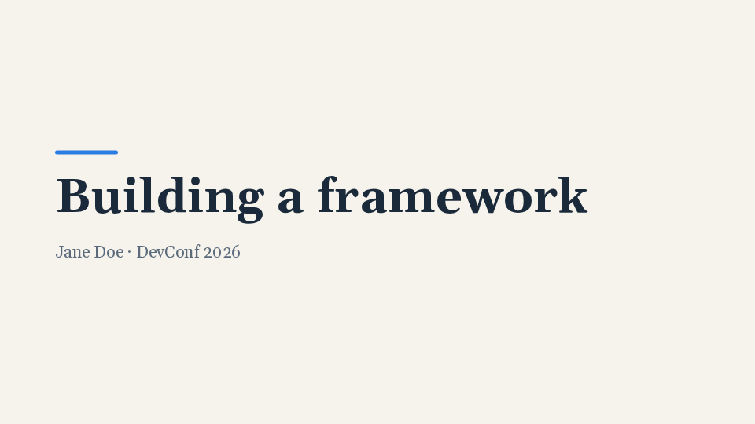

# Slides and layouts

A slide is a `Slide` inside the `Deck`. Its one prop, `layout`, names a layout: CSS that
arranges the slide's parts (the header, the body, the zones of its named templates, the footer).
Every slide finds those parts the same way, whatever its layout. Every prop and slot:
[Slide](../reference/components.md#slide).

## Layouts

`default` (a content slide), `cover`, `section`, `split` (a header over two named zones) and
`image-left` / `image-right` (a full-height, edge-to-edge picture beside the text). Each is one CSS
file of the library; the full table, and the tokens each one reads:
[Layouts](../reference/components.md#layouts). A name with no CSS behind it is the `default`
layout, its slides carrying the class `layout-<name>` for a theme or a deck to style. In a
TypeScript project the editor completes the names there are, and `vue-tsc` turns down any other
([Layout names in the editor](#layout-names-in-the-editor)).

A cover:

<!-- example:cover -->

```vue
<template lang="pug">
Deck
  Slide(layout="cover")
    .bar
    h1 Building a framework
    p.muted Jane Doe · DevConf 2026
</template>
```

<!-- /example -->



A split slide, its right side revealed at step 2:

<!-- example:split -->

```vue
<template lang="pug">
Deck
  Slide(layout="split")
    h2 Before and after
    template(#left)
      h3 #[Icon(name="lucide:git-fork")] Before
      ul
        li Every team rolled its own
        li Twelve ways to log
    template(#right)
      h3(v-step="2") #[Icon(name="lucide:package-check")] After
      ul(v-step="2")
        li One starter for all
        li One version to bump
</template>
```

<!-- /example -->


A picture beside the text, and a section divider:

```pug
Slide(layout="image-right")
  template(#image)
    Img(file="demo/landscape.svg" alt="A landscape")
  h2 One picture, one idea
  p The picture fills its side, top to bottom, edge to edge.

Slide(layout="section")
  h1 Why a framework?
```

A layout's tokens tune it, in a theme for every slide or on one slide, as any token:

```pug
Slide(layout="image-right" style="--ar-layout-image-right-columns: 3fr 2fr")   //- text 3/5, picture 2/5
  …
Slide(layout="split" style="--ar-layout-split-columns: 2fr 1fr")
  …
```

## Zones: header, body, footer

Every slide is laid out from the same parts; the `default` layout stacks them in a column inside
the slide's padding (`--ar-pad-y`, `--ar-pad-x`). Nothing to declare: the slide finds them.

```pug
Slide
  h2 Three pillars        //- header: the heading the slide starts with
  Cols(gap="lg")          //- body: everything else
    div …
```

- **Header**: when the default slot starts with an `h1` or `h2`, that heading is the slide's title
  and goes into the header; headings right after it go there too (a subtitle, or one title per
  step: `h2(v-step.only.collapse="1") …`, `h2(v-step.only.collapse="2") …`). Comments, `v-if`s
  that render nothing, `Notes` and `Background` before it do not count. A `#title` slot, when
  given, is the header instead, for headers with more than a heading (a kicker line, a logo); its
  first `h1`/`h2` is the title. A slide that starts with anything else has no header: the body
  takes the slide. The title carries the class `ar-title` and follows the `--ar-title-*` tokens;
  with `--ar-header-height` the header is a band of that height with the title centred in it
  ([Theme tokens](../reference/theme-tokens.md#slide-zones-and-content)). The slide's first
  heading is also its name in the jump menu, the presenter view and the notes pages.
- **Body**: everything else, in a column that fills the space under the header. It starts at the
  top, right under the header, so content begins at the same height on every slide. What does not
  fit overflows at the bottom, never at the top. What fills the body fills it: `Img`, `Snippet`,
  an element with `flex: 1`, the `1fr` rows of `Grid` and `Rows`. `Cols`, `Rows` and `Grid` placed
  directly in it shrink their auto rows to their content and move with the body, unless they hold
  something that needs the full height (a `Snippet`, an `Img`, another piece);
  `Cols(align="stretch")`, written out, keeps full-height columns.
- **Zones**: each named template (`template(#image)`, `template(#left)`…) is a zone of its own, a
  column with the class `ar-zone-<name>` (`#title` is the header's). The layout's CSS places it:
  `#image` beside the text in `image-*`, `#left` and `#right` under the header in `split`. In the
  page the zones always come after the header and the body, in the order written, whatever side
  the layout draws them on: in `image-left` a screen reader, the tab order and a copied text read
  the text first, then the picture.
- **Footer**: the `Deck`'s `#footer` slot, in a band `--ar-footer-height` tall (88 px) over the
  bottom of the slide, with the slide's side padding and its text in `--ar-footer-size` and
  `--ar-footer-color`. Its children sit in a row, spread by `--ar-footer-align` (`space-between`:
  one at the start, two at both ends). It sits in the slide's bottom padding, above the content;
  that padding is always at least as tall as the band (the larger of `--ar-pad-y` and
  `--ar-footer-height`), footer or not, so the content never sits under it and every slide's body
  ends at the same place. Shown on `default`, `split` and `image-*`
  (over the picture), hidden on `cover` and `section`: each layout says so with a token
  (`--ar-layout-cover-footer: flex` shows it on every cover). On a section it takes the section's
  text colour.
- `SlideNumber` keeps its corner (bottom right, on the footer band's line with the default
  height), outside the footer's content box. To have the number inside the footer, use the slot
  props (`{{ number }} / {{ total }}`) instead of `SlideNumber`.

### Placing the body

Where the body sits is the token `--ar-body-align` (`start`, the default; `center`; `end`): a theme
can change it for the whole deck, a layout for its slides. On one slide, a class does it:

| Class on a `Slide` | Its body |
|---|---|
| `.top` | from the top (the default, unless the theme says otherwise) |
| `.center` | centred both ways: in the space under the header, and its text (the title's too) |
| `.bottom` | at the bottom |

On a block inside a slide (a column of `Cols`, a cell of `Grid`, a block with a height), the same
classes place its content within it, when the block is taller than its content; `.center` centres
its text too.

```pug
Slide.center              //- one statement, in the middle
  h2 One thing to remember
  p Nothing ships without a test.

Slide.bottom
  h2 Fine print
  p.small.muted At the bottom of the slide.
```

### The footer on one slide

`no-footer` hides the deck's footer on a slide, `with-footer` shows it, whatever the layout says:

```pug
Deck
  template(#footer="{ number, total }")
    span ACME · DevConf 2026
    span {{ number }} / {{ total }}

  Slide.with-footer(layout="cover")
    h1 Shown on this cover too
  Slide.no-footer
    h2 Not on this one
```

## A layout of your own

A layout is one CSS file in the project's `src/layouts` folder, named as the layout:
`src/layouts/quote.css` styles every `Slide(layout="quote")`. The Vite plugin loads every file of
the folder, after the library's layouts and before the themes, with nothing to import
([Vite plugin](../reference/vite-plugin.md)). A file named like a library layout
(`src/layouts/cover.css`) replaces it: the library's is not loaded.

The slide is already in its parts (`.ar-header`, `.ar-body`, an `.ar-zone-<name>` per named
template, `.ar-footer`); the layout's CSS arranges them, under `.layout-<name>`. Its tokens follow
the library's convention, `--ar-layout-<name>-<thing>`, each with its default, so that a theme
can change them. A default that is another token (`--ar-accent`, `--ar-title`) must be resolved on
the slide, not at `:root` (`var()` is resolved where it is declared: a theme's `--ar-accent` would
never reach it), so the file resolves each public token into a private one in a
`:where(.layout-<name>)` block, and its rules read the private ones. A layout that moves the
slide's padding onto its zones (as `image-*` do) keeps them clear of the footer the same way:
`padding-bottom: max(var(--ar-pad-y), var(--ar-footer-height))`.

```css
/* src/layouts/quote.css: one big quote, centred on the slide, its author under it
     --ar-layout-quote-size     the quote's size             .8 x --ar-title
     --ar-layout-quote-mark     the opening mark's colour    --ar-accent
     --ar-layout-quote-footer   the deck's footer            none */
:where(.layout-quote) {
  --_ar-quote-size: var(--ar-layout-quote-size, calc(var(--ar-title) * .8));
  --_ar-quote-mark: var(--ar-layout-quote-mark, var(--ar-accent));
  --_ar-quote-footer: var(--ar-layout-quote-footer, none);
}
.layout-quote { justify-content: safe center; }       /* the slide is a column: centre it */
.layout-quote > .ar-body { flex: none; }              /* the body as tall as its content */
.layout-quote blockquote { margin: 0 0 .6em; font-size: var(--_ar-quote-size); line-height: 1.15; }
.layout-quote blockquote::before { content: '“'; color: var(--_ar-quote-mark); }
.layout-quote > .ar-footer { display: var(--_ar-quote-footer); }
```

```pug
Slide(layout="quote")
  blockquote Simplicity is prerequisite for reliability.
  p.muted Edsger W. Dijkstra
```

The library's own files, in the package's `layouts/` folder, are worked examples: `cover.css`
and `section.css` centre their content, `split.css` and `image-right.css` lay the slide out as a
grid and place its zones.

### Layout names in the editor

`Slide`'s `layout` is typed with the names of the layouts there are: in a TypeScript project the
editor (Volar) completes them, and `vue-tsc` turns down a name that is none (`layout="covr"`:
`Type '"covr"' is not assignable to type 'keyof SlideLayouts | undefined'`). The library's come
with the package (the interface `SlideLayouts`, exported by `araojs`); the project's are added by
the Vite plugin, which writes them into `src/arao-layouts.d.ts`, where the `tsconfig` of a Vite
project already looks (`src/**`):

```ts
// src/arao-layouts.d.ts: Generated by araojs/vite … Do not edit …
export {}
declare module 'araojs' {
  interface SlideLayouts {
    'quote': true
  }
}
```

- It is written when Vite starts (`npm run dev`, `npm run build`) and again when a layout file is
  added or removed during development, once the project has a layout of its own.
  Commit it, so that a type check (`vue-tsc --noEmit`, in CI) knows the project's layouts without
  running Vite first.
- A `tsconfig` that does not include `src/**` needs the file in its `include`, or the file moved
  where it looks: `arao({ dts: 'types/arao-layouts.d.ts' })`. `arao({ dts: false })` writes none
  ([Vite plugin](../reference/vite-plugin.md)).
- A layout chosen from data (`:layout="s.layout"`, with `s.layout` a `string`) fails the type check:
  type the data with the names, `keyof SlideLayouts` (`import type { SlideLayouts } from 'araojs'`), or
  cast it: `:layout="s.layout as keyof SlideLayouts"`.
- Turning `dts` off or moving it leaves the old file behind, still accepting its names: delete it.
- A name with no file of its own (a class a theme styles, `layout="wide"`) still works at
  runtime; for the type check to take it, declare it the same way in a `.d.ts` of the project:
  `declare module 'araojs' { interface SlideLayouts { wide: true } }`.
- Pug templates are type-checked only with Volar's Pug plugin
  ([Components](../reference/components.md), "In TypeScript").

## Lists and tables

- Lists: `--ar-list-gap` is the space between items (default `0`).
- Tables get a plain style from tokens: full width, collapsed borders, cells padded
  `--ar-table-pad`, a line `--ar-table-border` under every row, header cells in
  `--ar-table-head-color` on `--ar-table-head-bg`, every other body row on `--ar-table-stripe`.
  These rules have zero specificity: any rule of the deck (`.my-table td { … }`) wins.

```pug
Slide
  h2 Pace
  table
    thead
      tr
        th Period
        th Merged
    tbody
      tr
        td September
        td 32
      tr
        td October
        td 59
```
