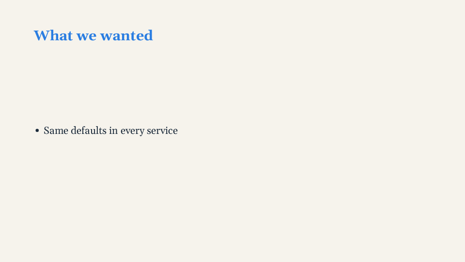
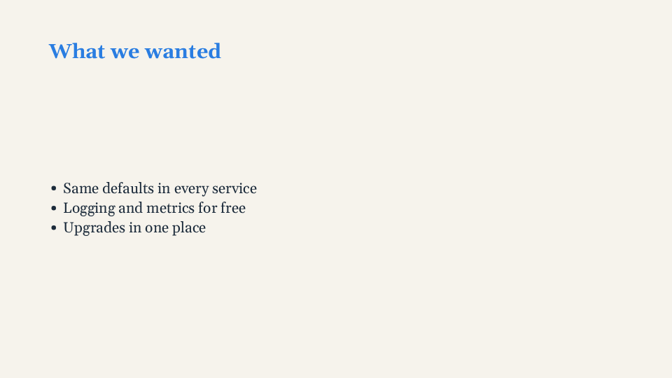

# Steps

Steps reveal a slide bit by bit. They are absolute numbers within a slide: `v-step="3"` means
"from step 3 of this slide", and step 1 is what shows when the slide arrives. The slide counts
its own steps, the largest one inside it: there is nothing to declare. Every rule:
[Directives](../reference/directives.md).

<!-- example:steps -->

```vue
<template lang="pug">
Deck
  Slide
    h2 What we wanted
    ul
      li Same defaults in every service
      li(v-step="2") Logging and metrics for free
      li(v-step="3") Upgrades in one place
</template>
```

<!-- /example -->

| Step 1 | Step 3 |
|---|---|
|  |  |

## Variants

```pug
Slide
  h2 One at a time
  p Always visible.
  p(v-step="2") From step 2.
  p(v-step.only="3") Only at step 3 (keeps its space).
  p(v-step.only.collapse="4") Only at step 4 (takes no space).
```

`.only` shows an element at one step only; `.collapse` makes it take no space while hidden, and
the elements around it glide into place.

## Reusable steps: v-step-from

Inside a reusable component, number its steps from 1 and place it with `v-step-from`: the deck
decides where they land, so the same component (or the same "animation") is reused at any point
of any slide.

```pug
//- src/slides/Card.vue — knows nothing about where it sits
.card
  h3 {{ title }}
  ul
    li(v-for="(item, i) in items" v-step="i + 1") {{ item }}
```
```pug
Slide
  h2 Two cards, one after the other
  Cols
    Card(title="A" :items="['One', 'Two', 'Three']" v-step-from="2")   //- steps 2, 3, 4
    Card(title="B" :items="['Four', 'Five']" v-step-from="5")          //- steps 5, 6
  Snippet(file="App.java" v-step-from="7" :highlights='{ "3": 2 }')    //- highlight at step 8
```

Code highlights are steps too ([Code](code.md)), and a component of your own can add steps with
`useSlide().requireSteps(n)` ([Extending](extending.md#changing-within-a-slide-useslide)).
