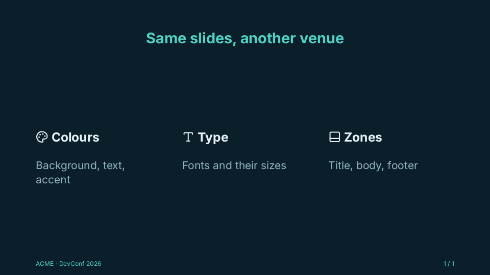

# Themes

Every token the engine reads has a default ([Theme tokens](../reference/theme-tokens.md), declared in
`styles/tokens.css`), and the defaults are the `default` theme: a light page, Georgia, a blue
accent, a light code window. It has no file; `default` is always a valid theme name.

A project theme declares only what it changes. This one is the examples' (`docs/examples/themes/`;
in a slides project, `src/themes/ocean.css`), with a deck that wears it:

<!-- example:themes/ocean.css -->

```css
/* docs/examples/themes/ocean.css: a theme declares only the tokens it changes */
[data-theme="ocean"] {
  --ar-bg: #0b1f2a;
  --ar-fg: #e6f1f5;
  --ar-muted: #8fb3c2;
  --ar-accent: #4fd1c5;
  --ar-accent-fg: #0b1f2a;
  --ar-letterbox: #06141b;
  --ar-font-sans: "Inter", system-ui, sans-serif;
  --ar-title-align: center;
  --ar-footer-color: var(--ar-accent);
}
```

<!-- /example -->

<!-- example:theme -->

```vue
<template lang="pug">
Deck(:themes="['ocean']")
  template(#footer="{ number, total }")
    span ACME · DevConf 2026
    span {{ number }} / {{ total }}

  Slide
    h2 Same slides, another venue
    Cols(gap="lg")
      div
        h3 #[Icon(name="lucide:palette")] Colours
        p.muted Background, text, accent
      div
        h3 #[Icon(name="lucide:type")] Type
        p.muted Fonts and their sizes
      div
        h3 #[Icon(name="lucide:panel-bottom")] Zones
        p.muted Title, body, footer
</template>
```

<!-- /example -->



Every token, with its default: [Theme tokens](../reference/theme-tokens.md).

## Where themes are found

A project theme is a CSS rule `[data-theme="<name>"] { --ar-…: …; }` in a CSS file of the
project's themes folder (`src/themes`; the [plugin](../reference/vite-plugin.md)'s `themes` option). It declares
only the tokens it changes, over the defaults. The plugin loads every CSS file directly in that
folder, after the engine's CSS, with nothing to import, and names the project's themes by their
selectors:

- a theme's name is the one in `[data-theme="<name>"]` (quoted or not), not the file's: one file
  may hold several themes (`[data-theme="venue"]` and `[data-theme="venue-dark"]`), and rules for
  several at once (`[data-theme^="venue"] { … }`, which names none by itself); comments do not
  count;
- a file that names no theme is still loaded (shared rules, `@font-face`) and Vite warns about
  it;
- a selector inside `:not(…)` names no theme; a name is read as the browser reads it (CSS escapes
  resolved, nothing trimmed), and one with white space in it is no theme's (Vite warns and it is
  skipped);
- subfolders hold what the themes use (pictures, `@import`-ed partials) and are not loaded on
  their own. The plugin follows a file's `@import` of a local partial (a path relative to the file,
  or from the project's root, `/styles/x.css`), all the way down, and its selectors name themes
  too; an `@import` of a package or a URL is not followed;
- a file added, removed or renamed while `npm run dev` runs is picked up, and so is an edit of a
  partial it imports (the page reloads when the theme names change).

**Where a theme can come from.** Two places:

1. **`src/themes`** (the plugin's `themes` folder): loaded with nothing to import, and offered by
   every deck without `themes`. The usual place.
2. **Any other stylesheet the project imports itself**: a CSS file in `src/styles` imported by
   `src/main.js` (after `'araojs'`, so that it comes after the engine's CSS, as `src/themes`
   does), a package's theme (`import 'some-theme/theme.css'`), a `.scss` file (with `sass`
   installed), a deck's own `<style>`, or a partial imported in a way the plugin does not follow.
   The plugin does not read these, so a deck without `themes` does not offer them; a deck that
   lists the name in `themes` wears it all the same, and `arao export --theme` takes it: before
   skipping a listed name, the engine looks for a `[data-theme="<name>"]` selector (outside
   `:not(…)`) in every stylesheet the page has loaded, inside `@media`, `@supports`, `@layer`,
   `@container`, nested rules and `@import`-ed sheets (a sheet of another origin that does not let
   its rules be read is passed over). It looks when the deck's list is read, as the deck opens:
   a stylesheet loaded later does not count.

`Deck(:themes)` picks the themes a deck can wear, in its order (the first is the one it opens in);
without it, the deck offers every theme there is: `default`, then the project's in alphabetical
order. A name there that is neither `default`, nor a project theme, nor a theme some stylesheet
of the page declares (above), is skipped, with one `[arao]` warning. `?theme=<name>` and `t`
(or the controls' picker) change the theme while presenting; `useDeck().themes` is the deck's
list.

Where tokens apply, from weakest to strongest:

1. the defaults, declared at the root with zero specificity (`:where(:root)`): they reach
   everything Arao draws, inside a theme or not (the presenter view and its notes, the deck
   list);
2. any rule of the project's own, `:root { --ar-accent: … }` included, which wins over a default;
3. the theme's rule, on the element that wears it (the audience's window, each slide area of the
   presenter view, the export's book);
4. a token set on any element inside (a layout, a slide, a table, `style="--ar-…"`).

A token whose default is another token (`--ar-footer-color` is `--ar-muted`, the slide title's
colour is `--ar-accent`) follows that token wherever it is read: a theme that changes `--ar-muted`
changes the footer too, unless it sets `--ar-footer-color`. The deck's own interface (the
controls, the presenter view, the export's notes pages) has tokens too: a theme restyles the
controls and the notes pages (they sit inside it); the presenter view sits outside every theme,
so its tokens are set at `:root`.

## Another theme

```css
/* src/themes/venue.css: found and loaded by the plugin; Deck(:themes) may name 'venue' */
[data-theme="venue"] {
  --ar-letterbox: #111; --ar-bg: #fff; --ar-fg: #222; --ar-muted: #777;
  --ar-accent: #0a7;
  --ar-font-sans: system-ui, sans-serif;
  --ar-title: 88px; --ar-radius: 12px;
  --ar-code-bg: #f6f8fa; --ar-code-bar: #e6e8eb;
}
```

In a slide, style through tokens (`color: var(--ar-accent)`,
`background: color-mix(in srgb, var(--ar-fg) 8%, var(--ar-bg))`) rather than fixed colours or
fonts: a venue-specific look is a new theme, not edits to slides.

## Sizes

Rules of thumb for a 1920x1080 canvas (and what the defaults do):

- **Safe margin** ≈ 5–7 % of each side, for projectors that crop the edges: `--ar-pad`
  (110 x 140 px).
- **Header** ≈ 12–15 % of the height for the title zone (a band, if any: `--ar-header-height`).
- **Footer** ≈ 5–8 % of the height: the default band is 88 px, in place of the bottom padding,
  with 24 px text.
- **Body text** 36–44 px (`--ar-text-base`: 42 px); nothing under ≈ 28 px except the footer and
  dense code.
